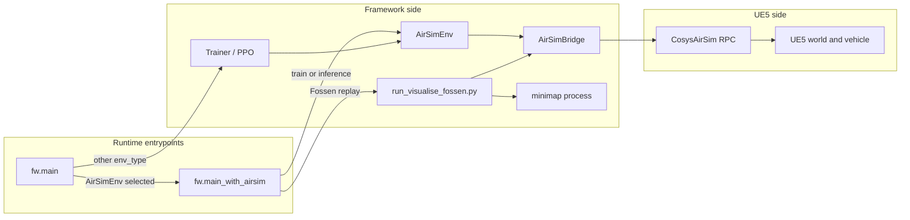
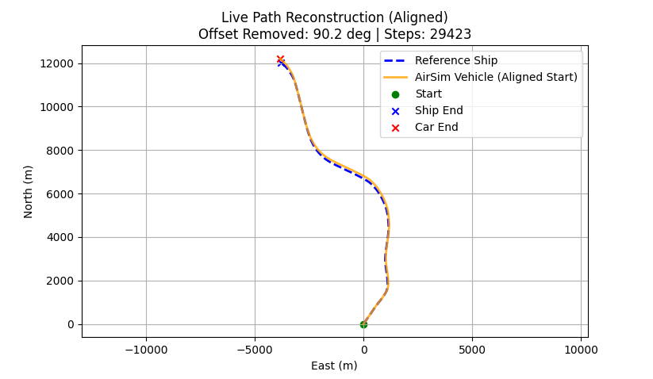

# RudoLF

Multi-paradigm Reinforcement Learning Framework


> The following project is composed of a Gazebo simulator and two Python simulators (discrete and continuous env) used to train an agent for autonomous navigation. The trained policy can be visualized in both **Matplotlib** and **Unreal Engine 5** (via CosysAirSim) simultaneously.

---

## UE5 Visualization — CosysAirSim Bridge

RudoLF can now train and visualise navigation policies in **Unreal Engine 5** through CosysAirSim. The current integration supports two complementary modes:

- **AirSim-native execution** through `AirSimEnv`, where UE5 is the physics source of truth.
- **Framework replay in UE5** through `run_visualise_fossen.py`, where `PySimEnv` or `FhSimEnv` remains authoritative and UE5 acts as renderer.


### Recent Updates

- Shared utility code was consolidated into `fw/common/airsim` (`tools` and `classes`) to reduce duplicate path, angle, and configuration logic.
- AirSim calibration and telemetry utilities now live under `fw.common.airsim.tools`.
- The live UE5 minimap now runs in a separate child process instead of a thread, which prevents GUI redraws from stalling the main replay loop.
- Fossen replay in UE5 now skips blocking interpolation when `simulation_speed` makes the available wall-clock update time shorter than the effective render interval.
- The minimap now docks itself near the top-right of the UE5 monitor, uses a local follow-view around the vessel, and recenters when the ship approaches the edge of the visible section.
- The AirSim documentation and architecture notes were updated to match the current split between `fw.main`, `fw.main_with_airsim`, `AirSimEnv`, and Fossen replay.
- `fw.main` visualisation now respects the configured environment order for list-based `env_type` (for example `['PySimEnv', 'AirSimEnv']` runs `PySimEnv` first, then AirSim).
- The risk-based test planning document now includes broader risk coverage, detection signals, planned test types, acceptance thresholds, and a forward outlook for later roadmap tasks.

### Architecture



### Key Components

| Component           | File                                          | Purpose                                           |
| ------------------- | --------------------------------------------- | ------------------------------------------------- |
| **AirSim Bridge**   | `src/airsim/communication/airsim_bridge.py`   | RPC lifecycle, control forwarding, pose mirroring |
| **Coord Transform** | `src/airsim/communication/coord_transform.py` | Fossen ↔ AirSim bidirectional mapping             |
| **RL Environment**  | `src/airsim/environments/airsim_env.py`       | Gymnasium env for training inside UE5             |
| **Configuration**   | `src/airsim/config/airsim_config.py`          | Connection and runtime settings                   |
| **Path Plotter**    | `src/airsim/inference/plot_airsim_path.py`    | Dead-reckoning path reconstruction from telemetry |
| **Calibration**     | `src/fw/common/airsim/tools/calibrate_coords.py` | Interactive Fossen↔AirSim coordinate calibration  |
| **Telemetry Log**   | `src/airsim/config/airsim_telemetry.csv`      | Optional bridge-level telemetry export            |

### Runtime Strategy

- `python -m fw.main` is the default launcher.
- `src/fw/config.py` controls the generic framework flow through `env_type` and `action` (`train` or `visualize`).
- For both `action = "train"` and `action = "visualize"`, `fw.main` executes environments in the configured order from `env_type`.
- When AirSim appears in an `env_type` list, `fw.main_with_airsim` is executed as the AirSim step at its position in sequence.
- Non-AirSim environments continue through the generic framework trainer flow.
- If the ordered AirSim step fails (for example UE5 unavailable), that AirSim step is skipped and already-completed non-AirSim steps are not retrained.
- If the AirSim extension fails with a non-zero exit code, `fw.main` falls back to the default framework entrypoint.
- `src/fw/config.py` now supports `env_type`, so the generic framework flow can select `PySimEnv`, `FhSimEnv`, `AirSimEnv`, `PySimPolarEnv`, or `LunarLander` without breaking the current 2D default.

### AirSim Execution Notes

- `AirSimEnv.step()` validates actions before mapping them to UE5 controls.
- Lock-step stepping now waits for a newer UE5 physics timestamp after `simContinueForFrames()`.
- Per-step telemetry includes `physics_wait_s`, `step_latency_s`, and `ue5_timestamp`, both in `step()` info and in the episode CSV logger.
- `run_visualise_fossen.py` now snaps visual updates directly when `simulation_speed` makes the allocated wall-clock update time shorter than the effective render interval, which reduces abrupt pacing drops at high replay speeds.
- The live minimap is isolated in a separate child process instead of a thread, so viewport redraws and Tk event handling do not stall the main UE5 replay loop.
- Fossen replay remains available through `python -m airsim.inference.run_visualise_fossen`.

### Path Reconstruction

Telemetry data can be visualized with `plot_airsim_path.py`, which reconstructs both paths via dead reckoning:



### Quick Start

1. Ensure **CosysAirSim** is running with the UE5 environment.
2. Choose the generic framework run in `src/fw/config.py`:
   - Set `env_type` to one of `PySimEnv`, `FhSimEnv`, `PySimPolarEnv`, `LunarLander`, or `AirSimEnv`.
   - Use an ordered list in `env_type` (for example `['PySimEnv', 'AirSimEnv']`) to run multiple environments sequentially in that same order.
   - Set `action` to `train` or `visualize`.
3. Set `env_type` to `"AirSimEnv"` when you want only the AirSim step.
4. For AirSim training through `fw.main`, leave both `fossen_visualise` and `inference_visualise` disabled in `src/airsim/config/runtime_settings.json`.
5. Tune training speed via `training.speed_profile` (`normal`, `safe`, `fast`, `turbo`, `custom`) in `src/airsim/config/runtime_settings.json`.
6. For AirSim visualisation through `fw.main`, keep `env_type = "AirSimEnv"` and enable either `fossen_visualise` or `inference_visualise` in `src/airsim/config/runtime_settings.json`.
7. Run the default framework entrypoint:
   ```bash
   cd src
   python -m fw.main
   ```
8. Run the AirSim-only extension directly when you do not want fallback behavior:
   ```bash
   cd src
   python -m fw.main_with_airsim
   ```
9. _(Optional)_ Visualize telemetry in real-time:
   ```bash
   python -m airsim.inference.plot_airsim_path
   ```
10. Calibration launcher options:

```bash
cd src
python -m fw.common.airsim.tools.calibrate_coords
```

```bash
cd src
python -m fw.common.airsim.tools.calibrate_coords
```

### Configuration Reference

| Parameter                | Default             | Description                                                |
| ------------------------ | ------------------- | ---------------------------------------------------------- |
| `env_type`               | `PySimEnv`          | Generic framework environment selector used by `fw.main`   |
| `action`                 | `train`             | Generic framework action (`train` or `visualize`)          |
| `ip`                     | `""`                | AirSim server IP, empty meaning localhost                  |
| `port`                   | `41451`             | AirSim RPC port                                            |
| `simulation_speed`       | `1.0`               | Simulation speed multiplier for UE5 runs                   |
| `use_pause_stepping`     | `True` for training | Enables deterministic frame stepping                       |
| `physics_update_timeout` | `1.0`               | Watchdog timeout while waiting for a new UE5 physics state |

AirSim runtime configuration now has dedicated sections:

- `visualization`: Fossen/inference visual replay behavior.
- `training`: AirSim training speed controls (`speed_profile` and related stepping values).
- `airsim`: bridge connectivity and save-slot ownership.

`runtime_settings.json` is strict JSON, so inline explanations are stored in `_remarks` objects.

For high-speed Fossen replay, `simulation_speed`, `min_render_hz`, and `render_interpolation_steps` must be interpreted together: if the replay speed makes the available wall-clock budget per framework step smaller than the effective UE5 render interval, the visualisation now snaps directly to the target pose instead of forcing a blocking interpolation loop.

> **Full documentation:** See [`src/airsim/README.md`](src/airsim/README.md) for the complete AirSim package documentation, and [`src/airsim/verantwoording_workflow.md`](src/airsim/verantwoording_workflow.md) for the workflow rationale.

### AirSim Tests

Run the AirSim test suite from the repository root:

```bash
python -m pytest tests/airsim -v
```

Inference routing test (Fossen visualisation dispatch from `fw.main_with_airsim`) is located at:

`tests/airsim/inference/test_fossen_visualisation_dispatch.py`

Focused visualisation helper tests are located at:

- `tests/airsim/inference/test_minimap_layout.py`
- `tests/airsim/inference/test_fossen_visualisation_timing.py`

The project-level risk-based test strategy is documented in [`tests/test_planning.md`](tests/test_planning.md).

---

## ROS2 and Gazebo

- ROS2 Humble
- Gazebo Garden

```bash
source path/to/ros/install/setup.bash
cd path/to/vrx/project
./run.sh
source install/setup.bash
ros2 launch competition_custom.launch.py world:=sydney_regatta_custom
```

## Python Simulator

- Python 3.12
- Numpy, Matplotlib, Stable Baselines 3

```bash
cd src
python -m fw.main
```

---

## AirSim Package Reference

The `src/airsim/` package is a self-contained module that encapsulates all CosysAirSim integration logic. It is organised into the following subpackages:

| Subpackage       | Purpose                                                              |
| ---------------- | -------------------------------------------------------------------- |
| `common/`        | Shared utilities and data classes (`tools/` and `classes/`)          |
| `config/`        | Runtime settings, connection settings, and calibration files         |
| `communication/` | Bridge transport and coordinate transform between Fossen and AirSim  |
| `environments/`  | Gymnasium RL environment that uses UE5 physics via CosysAirSim       |
| `train/`         | Entry points for RL training inside UE5                              |
| `inference/`     | Live and headless telemetry visualisation                            |
| `tools/`         | Backward-compatible wrappers for calibration and telemetry utilities |
| `poc/`           | Frozen proof-of-concept snapshots of the original bridge and trainer |
| `tests/`         | Pytest unit, integration, and regression tests plus test planning    |

For detailed documentation on each component, coordinate frames, runtime routing, and telemetry schema, see **[`src/airsim/README.md`](src/airsim/README.md)**.
