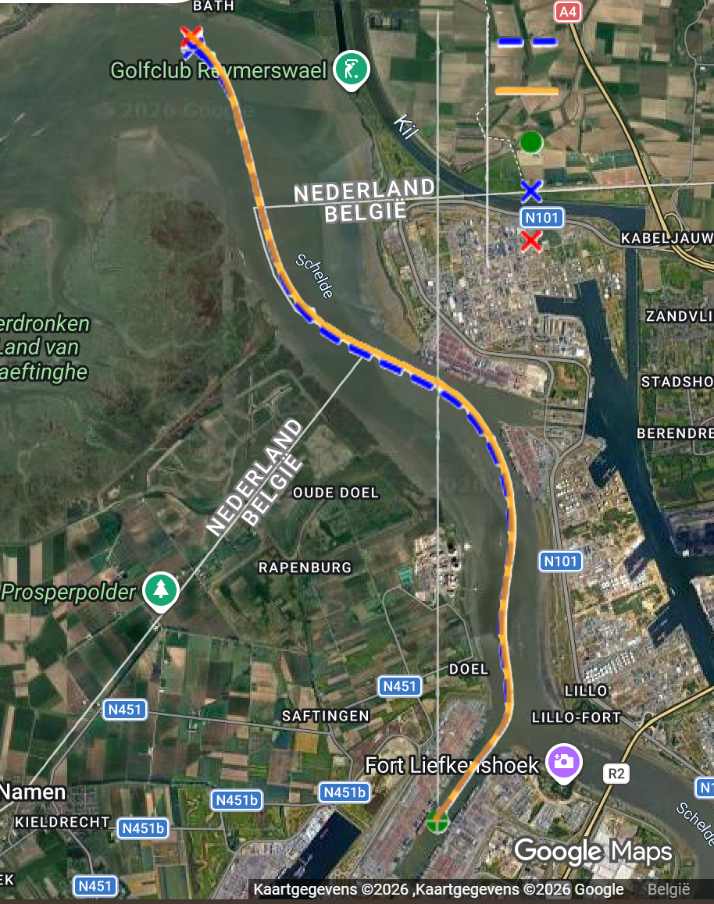

# RudoLF

Multi-paradigm Reinforcement Learning Framework


> The following project is composed of a Gazebo simulator and two Python simulators (discrete and continuous env) used to train an agent for autonomous navigation. The trained policy can be visualized in both **Matplotlib** and **Unreal Engine 5** (via CosysAirSim) simultaneously.

---

## UE5 Visualization — CosysAirSim Bridge (WIP)

RudoLF can now drive a vehicle inside **Unreal Engine 5** in real-time (TESTING PHASE!!!), mirroring the RL agent's behavior from the Fossen ship simulation. The bridge translates RL actions (`[rudder, thrust]`) into AirSim `CarControls` (`[steering, throttle]`), achieving synchronized path following between both environments.



### Architecture

```
┌─────────────────┐         ┌──────────────────┐         ┌──────────────────┐
│  RL Agent (PPO)  │────────▶│  Fossen Ship Sim  │────────▶│    Matplotlib     │
│   (Stable B3)    │  action │  (Python, NED)    │  state  │   Live Animation  │
└─────────────────┘         └────────┬─────────┘         └──────────────────┘
                                     │ ship_state
                                     ▼
                            ┌──────────────────┐         ┌──────────────────┐
                            │  AirSim Bridge    │────────▶│   Unreal Engine 5 │
                            │  (PID + XTE)      │  steer  │   CosysAirSim     │
                            └──────────────────┘  + thr   └──────────────────┘
```

### Key Components

| Component           | File                                          | Purpose                                           |
| ------------------- | --------------------------------------------- | ------------------------------------------------- |
| **AirSim Bridge**   | `src/airsim/communication/airsim_bridge.py`   | PID+FF steering & PI throttle controller          |
| **Coord Transform** | `src/airsim/communication/coord_transform.py` | Fossen ↔ AirSim bidirectional mapping             |
| **RL Environment**  | `src/airsim/environments/airsim_env.py`       | Gymnasium env for training inside UE5             |
| **Configuration**   | `src/airsim/config/airsim_config.py`          | All tuning parameters (PID gains, network, etc.)  |
| **Path Plotter**    | `src/airsim/inference/plot_airsim_path.py`    | Dead-reckoning path reconstruction from telemetry |
| **Calibration**     | `src/airsim/tools/calibrate_coords.py`        | Interactive Fossen↔AirSim coordinate calibration  |
| **Telemetry Log**   | `src/airsim/config/airsim_telemetry.csv`      | Per-step speed, heading, steering, and error data |

### Control Strategy

- **Steering**: PID + Feedforward + Cross-Track Error correction
  - `Kp` heading error + `Ki` integral + `Kd` derivative + `Kff` yaw rate + XTE lateral correction
- **Throttle**: PI controller tracking cumulative path distance (arc length)
  - Cornering logic reduces speed during large heading deviations

### Path Reconstruction

Telemetry data can be visualized with `plot_airsim_path.py`, which reconstructs both paths via dead reckoning:


### Quick Start

1. Ensure **CosysAirSim** is running with the UE5 environment.
2. In `src/airsim/config/airsim_config.py`, set:
   ```python
   "use_airsim": True,
   ```
3. Run the simulation:
   ```bash
   cd src
   python -m fw.main
   ```
4. _(Optional)_ Visualize telemetry in real-time:
   ```bash
   python -m airsim.inference.plot_airsim_path
   ```

### Configuration Reference

| Parameter              | Default | Description                                              |
| ---------------------- | ------- | -------------------------------------------------------- |
| `airsim_kp`            | `5.0`   | Proportional gain — steering response to heading error   |
| `airsim_ki`            | `0.5`   | Integral gain — eliminates steady-state heading drift    |
| `airsim_kd`            | `1.0`   | Derivative gain — dampens steering oscillation           |
| `airsim_ff`            | `0.5`   | Feedforward gain — proactive steering from ship yaw rate |
| `airsim_lat_gain`      | `0.5`   | Cross-Track Error gain — corrects lateral position drift |
| `airsim_speed_scale`   | `1.05`  | Speed multiplier to match simulation units               |
| `airsim_log_telemetry` | `True`  | Logs step-by-step control data to CSV                    |

> **Full documentation:** See [`src/airsim/README.md`](src/airsim/README.md) for the complete AirSim package documentation, including runtime entrypoints, coordinate frame details, telemetry schema, and test suite information.

### AirSim Tests

Run the AirSim test suite from the repository root:

```bash
python -m pytest tests/airsim -v
```

Inference routing test (Fossen visualisation dispatch from `fw.main_with_airsim`) is located at:

`tests/airsim/inference/test_fossen_visualisation_dispatch.py`

---

## ROS2 and Gazebo

- ROS2 Humble
- Gazebo Garden

```bash
source path/to/ros/install/setup.bash
cd path/to/vrx/project
./run.sh
source install/setup.bash
ros2 launch competition_custom.launch.py world:=sydney_regatta_custom
```

## Python Simulator

- Python 3.12
- Numpy, Matplotlib, Stable Baselines 3

```bash
cd src
python -m fw.main
```

---

## AirSim Package Reference

The `src/airsim/` package is a self-contained module that encapsulates all CosysAirSim integration logic. It is organised into the following subpackages:

| Subpackage       | Purpose                                                              |
| ---------------- | -------------------------------------------------------------------- |
| `config/`        | AirSim-specific PID gains, network settings, and calibration files   |
| `communication/` | Bridge adapter and coordinate transform between Fossen and AirSim    |
| `environments/`  | Gymnasium RL environment that uses UE5 physics via CosysAirSim       |
| `train/`         | Entry points for RL training inside UE5                              |
| `inference/`     | Live and headless telemetry visualisation                            |
| `tools/`         | Interactive calibration wizard and offline telemetry analysis        |
| `poc/`           | Frozen proof-of-concept snapshots of the original bridge and trainer |
| `tests/`         | Pytest unit tests (33 tests, runs without UE5)                       |

For detailed documentation on each component, coordinate frames, control strategy, and telemetry schema, see **[`src/airsim/README.md`](src/airsim/README.md)**.
