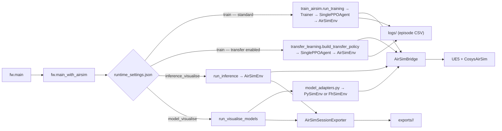

# AirSim Integration Manual

This document is the single technical reference for the AirSim integration in RudoLF. It covers installation, configuration, all runtime modes, architecture, and testing.

---

## Table of Contents

1. [Overview](#1-overview)
2. [Installation and Setup](#2-installation-and-setup)
3. [How to Invoke AirSim](#3-how-to-invoke-airsim)
4. [Configuration Reference](#4-configuration-reference)
   - [config.py](#41-configpy)
   - [runtime_settings.json](#42-runtime_settingsjson)
5. [Training](#5-training)
   - [Standard Training](#51-standard-training)
   - [Speed Profiles](#52-speed-profiles)
   - [Curriculum Learning](#53-curriculum-learning)
   - [Transfer Learning](#54-transfer-learning)
6. [Visualization of Trained Models in AirSim](#6-visualization-of-trained-models-in-airsim)
   - [Model Selection](#61-model-selection)
   - [Visualization Settings](#62-visualization-settings)

7. [Inference of AirSim-Trained Models](#7-inference-of-airsim-trained-models)
8. [Adding Support for New Model Families](#8-adding-support-for-new-model-families)
9. [Architecture](#9-architecture)
   - [Module Layout](#91-module-layout)
   - [Runtime Routing](#92-runtime-routing)
   - [AirSimEnv](#93-airsimenv)
   - [Communication Layer](#94-communication-layer)
   - [Coordinate System](#95-coordinate-system)
   - [Steering Dynamics](#96-steering-dynamics)
   - [Exports](#97-exports)
10. [Testing](#10-testing)

---

## 1. Overview

The AirSim integration layer connects the RudoLF reinforcement learning framework to Unreal Engine 5 via CosysAirSim. It provides three runtime paths:

- **AirSimEnv training** — UE5 physics is the authoritative simulator during PPO training.
- **AirSimEnv inference** — a trained AirSimEnv policy is run against live UE5 state.
- **Framework-model replay** — a framework-trained model (PySimEnv or FhSimEnv) drives physics; UE5 is used as a renderer and visual mirror.

The integration is scoped to the `src/airsim/` package. All AirSim behavior is invoked through the standard framework entry point at `src/fw/main.py` using configuration in `src/fw/config.py` and `src/airsim/config/runtime_settings.json`.

---

## 2. Installation and Setup

### Prerequisites

- Windows machine with Unreal Engine 5 installed.
- The RudoLF UE5 project with the CosysAirSim integration enabled.
- Python 3.12 (or the version that matches the project `.venv`).
- Access to the `package_airsim/cosysairsim.zip` file in the repository root.

### Step 1 — Create and Activate `.venv`

From the repository root:

```powershell
py -3.12 -m venv .venv
.\.venv\Scripts\Activate.ps1
```

If PowerShell blocks script execution:

```powershell
Set-ExecutionPolicy -Scope Process -ExecutionPolicy Bypass
.\.venv\Scripts\Activate.ps1
```

Upgrade packaging tools before installing dependencies:

```powershell
python -m pip install --upgrade pip setuptools wheel
```

### Step 2 — Install All Dependencies from `requirements.txt`

```powershell
python -m pip install -r requirements.txt
```

This installs all project dependencies including the base `cosysairsim` package. After this step, `cosysairsim` is present at:

```text
.venv\Lib\site-packages\cosysairsim\
```

### Step 3 — Replace `cosysairsim` with the Bespoke Project Version

The standard pip-installed `cosysairsim` is missing project-specific RPC calls required by RudoLF. You must replace it with the bespoke version bundled in the repository.

1. Locate the bespoke package in the repository root:

```text
package_airsim\cosysairsim.zip
```

2. Extract the contents of `cosysairsim.zip`. The zip contains a `cosysairsim` folder.

3. Delete or rename the installed package folder:

```text
.venv\Lib\site-packages\cosysairsim\
```

4. Copy the extracted `cosysairsim` folder into that exact location:

```text
.venv\Lib\site-packages\cosysairsim\
```

After replacement the import path is unchanged — only the contents differ.

Verify the replacement:

```powershell
python -c "import cosysairsim; print(cosysairsim.__file__)"
```

The printed path must point inside `.venv\Lib\site-packages\cosysairsim\`.

### Step 4 — Prepare UE5

- Open the RudoLF UE5 project.
- Ensure the CosysAirSim plugin is enabled in the project.
- Enter Play mode so the AirSim RPC server becomes reachable.

Default connection parameters expected by RudoLF:

| Parameter | Default |
|-----------|---------|
| IP | `127.0.0.1` (localhost) |
| Port | `41451` |
| Save slot | `simulator_1` |

These are configurable in `src/airsim/config/runtime_settings.json` under the `airsim` section.

### Step 5 — Validate the Connection

With UE5 running in Play mode:

```powershell
cd src
python -m pytest tests/airsim/communication/test_bridge.py -q
```

Or run the full entry point and check for a successful connection:

```powershell
cd src
python -m fw.main_with_airsim
```

### Step 6 — Optional: Coordinate Calibration

If calibration data is missing or needs to be refreshed:

```powershell
cd src
python -m fw.common.airsim.tools.calibrate_coords
```

This creates or updates `src/airsim/config/calibration.json`, which stores the anchor pair, scale, rotation, and axis mirrors used to convert between framework coordinates (east/north) and AirSim coordinates (north/east).

### Troubleshooting

| Symptom | Cause | Fix |
|---------|-------|-----|
| `cosysairsim` imports but RPC calls fail | Public pip version still installed | Re-copy the bespoke folder from `package_airsim/cosysairsim.zip` into `.venv\Lib\site-packages\` |
| UE5 starts but RudoLF does not connect | Port mismatch or firewall | Verify port matches `runtime_settings.json`, check firewall |
| Visualisation starts in wrong state | Save slot reload incomplete | Verify the save slot exists and UE5 had enough time to reload |

---

## 3. How to Invoke AirSim

**AirSim is only invoked through `src/fw/main.py` and configured in `src/fw/config.py`.**

Direct execution of any file inside `src/airsim/` is not the supported workflow. The framework entry point is always:

```powershell
cd src
python -m fw.main
```

### How Routing Works

The execution decision is made in three layers:

**Layer 1 — `src/fw/config.py`** selects the simulators and the high-level action:

- `env_type` — which environment(s) to run (can be a single name or an ordered list).
- `action` — `"train"` or `"visualize"`.

**Layer 2 — `src/fw/main.py`** executes environments in the configured order:

- Non-AirSim environments (PySimEnv, FhSimEnv, etc.) are batched and run through the generic Trainer.
- Whenever `AirSimEnv` appears in the ordered list, that step is delegated to `fw.main_with_airsim`.
- If a delegated AirSim step fails (UE5 unreachable), that step is skipped and execution continues with remaining environments.

**Layer 3 — `src/fw/main_with_airsim.py`** reads `src/airsim/config/runtime_settings.json` and decides:

- `action = "train"` → AirSimEnv training via `train_airsim.run_training()`.
- `action = "visualize"` → checks runtime flags:
  - `visualization.model_visualise = true` → framework-model replay via `run_visualise_models.py`.
  - `visualization.inference_visualise = true` → AirSimEnv inference via `run_inference.py`.
  - If both flags are true, `model_visualise` wins.
  - If neither flag is set, falls back to the generic trainer visualizer.

### Runtime Decision Flowchart

```
fw.main (config.py env_type/action)
    │
    ├── non-AirSim env → generic Trainer
    │
    └── AirSimEnv entry → fw.main_with_airsim
            │
            ├── action = "train"
            │       └── train_airsim.run_training()
            │               ├── transfer_learning.enabled = true  → inject transferred policy
            │               └── standard → Trainer → SinglePPOAgent → AirSimEnv → UE5
            │
            └── action = "visualize"
                    ├── model_visualise = true  → run_visualise_models.py (framework replay)
                    ├── inference_visualise = true  → run_inference.py (AirSim inference)
                    └── neither → generic trainer.visualize()
```

### Verbose Mode

Set `FW_AIRSIM_VERBOSE=1` to enable detailed AirSim and simulator log output:

```powershell
$env:FW_AIRSIM_VERBOSE = "1"
cd src
python -m fw.main
```

---

## 4. Configuration Reference

### 4.1 `config.py`

File: `src/fw/config.py`

This file controls framework-level behavior. For AirSim, only two keys matter:

| Key | Type | Example | Description |
|-----|------|---------|-------------|
| `env_type` | `str` or `list[str]` | `"AirSimEnv"` or `["PySimEnv", "AirSimEnv"]` | Which environment(s) to run, in order. Include `"AirSimEnv"` to activate the AirSim step. |
| `action` | `str` | `"train"` or `"visualize"` | High-level mode for all environments. |

Valid `env_type` values: `"PySimEnv"`, `"FhSimEnv"`, `"AirSimEnv"`, `"PySimPolarEnv"`, `"LunarLander"`.

Example — AirSim training only:

```python
CONFIG_PARAMETERS = {
    'env_type': ["AirSimEnv"],
    'action': "train",
    ...
}
```

Example — PySimEnv training followed by AirSim training:

```python
CONFIG_PARAMETERS = {
    'env_type': ["PySimEnv", "AirSimEnv"],
    'action': "train",
    ...
}
```

All AirSim-specific parameters (speed, curriculum, transfer learning, connection, visualization mode) are configured in `runtime_settings.json`, not in `config.py`.

### 4.2 `runtime_settings.json`

File: `src/airsim/config/runtime_settings.json`

This file refines AirSim behavior once the AirSim step is selected. It is read by `fw.main_with_airsim`. All keys have code-level defaults; absent keys fall back to those defaults, not to JSON zeros.

The file has four top-level sections:

---

#### `airsim` — Connection and Bridge Settings

| Key | Default | Description |
|-----|---------|-------------|
| `use_airsim` | `true` | Master on/off switch for the AirSim bridge. |
| `ip` | `""` | AirSim RPC host IP. Empty string resolves to `127.0.0.1`. |
| `port` | `41451` | AirSim RPC port. |
| `timeout` | `10.0` | Connection timeout in seconds. |
| `max_retries` | `3` | Maximum connection retry attempts. |
| `health_check_interval` | `30.0` | Seconds between periodic health-check pings. |
| `save_slot` | `"simulator_1"` | UE5 save slot loaded on startup world reload. |
| `simulation_speed` | `20.0` | Base UE5 speed multiplier (used for visualization; training overrides this via speed profile). |
| `csv_log_path` | `""` | Optional CSV path for bridge-level low-level telemetry. Empty string disables. |

---

#### `training` — Training Behavior

| Key | Default | Description |
|-----|---------|-------------|
| `speed_profile` | `"safe"` | Named timing preset. See [Speed Profiles](#52-speed-profiles). |
| `max_policy_updates` | `200` | PPO policy update count before the stop condition triggers. |
| `max_steps` | `120000` | Episode step cap during training. |
| `simulation_speed` | `20.0` | UE5 speed multiplier (overridden by the active speed profile). |
| `use_pause_stepping` | `true` | Deterministic pause-step mode. Recommended for all non-debug runs. |
| `use_sim_time_stepping` | `true` | Advance each RL step by a fixed simulated time via `simContinueForTime()`. Requires `use_pause_stepping`. |
| `sim_time_per_action` | `0.05` | Simulated seconds per RL action when `use_sim_time_stepping` is active. |
| `frames_per_step` | `8` | UE5 physics frames per RL step when using frame stepping (not sim-time stepping). |
| `time_step` | `0.05` | Nominal RL step duration (overwritten by `sim_time_per_action` when both pause flags are active). |
| `physics_update_timeout` | `1.2` | Watchdog timeout (s) waiting for frame/sim-time step completion. |
| `state_poll_interval` | `0.003` | Polling cadence (s) waiting for UE5 to re-pause after a step. |
| `normalize_reward` | `true` | Scale shaped reward into `[-1, 1]` before PPO consumes it. |
| `reward_normalization_scale` | `5.0` | Absolute scale used for reward clipping. |
| `reset_mode` | `"rewind_pose"` | `rewind_pose` teleports to start without a full bridge reset. `bridge_reset` uses the heavier AirSim reset path. |
| `load_world_on_start` | `true` | Issue one save-slot world reload at startup to force the spawn state. |
| `capture_live_start_pose` | `true` | After startup reload settles, adopt the live spawn pose as the reset anchor. |
| `no_rendering_mode` | `true` | Disable UE5 scene rendering during training (keeps physics active, reduces GPU load). |
| `draw_calibration_reference` | `false` | Draw calibration ridges, route line, and markers during training. |
| `episode_log_path` | `"logs/airsim_training_episode_log.csv"` | CSV path for per-step AirSim training telemetry. Empty string disables. |
| `progress_log_interval_steps` | `100` | Print a training heartbeat every N AirSim steps. `0` disables. |
| `log_pause_watchdog_warnings` | `false` | Print pause watchdog timeout warnings (false keeps output clean). |
| `control_interface` | `"car_physics"` | UE5 control interface. Keep `"car_physics"` for the current ship setup. |
| `observation_profile` | `"ppo_route_relative_car"` | Observation contract. See [AirSimEnv](#93-airsimenv). |
| `guidance_assist_enabled` | `false` | Add a residual guidance correction to policy outputs. Disabled for PPO training stability. |
| `steering_dynamics_enabled` | `true` | Apply vessel-like steering dynamics before controls are sent to UE5. |
| `steering_smoothing_alpha` | `0.65` | Low-pass blend factor for steering dynamics. Higher = tracks policy faster. |
| `max_steering_rate_per_second` | `3.2` | Maximum steering change per simulated second in normalized `[-1, 1]` space. |
| `curriculum_enabled` | `false` | Activate checkpoint-based episode start randomization. See [Curriculum Learning](#53-curriculum-learning). |

---

#### `visualization` — Visualization and Inference Behavior

| Key | Default | Description |
|-----|---------|-------------|
| `model_visualise` | `true` | Run framework-model replay in UE5 via `run_visualise_models.py`. |
| `inference_visualise` | `false` | Run AirSimEnv inference via `run_inference.py`. |
| `model_family` | `"auto"` | Adapter selector for replay: `auto`, `pysim`, or `fhsim`. `auto` infers from checkpoint filename. |
| `model_path` | `"models/PySimEnv_PPO_policy.zip"` | Path to the framework `.zip` policy used by `run_visualise_models`. Relative to repo root or absolute. |
| `inference_model_path` | `"models/AirSimEnv_PPO_policy.zip"` | Path to the AirSim `.zip` policy used by `run_inference`. Ignored when `model_visualise` is true. |
| `environment_name` | `"auto"` | Framework environment name for replay. `auto` lets the adapter resolve it. |
| `episodes` | `1` | Number of replay/inference episodes before the visualizer exits. |
| `max_steps` | `60000` | Episode step cap for visualization. |
| `device` | `"cpu"` | PyTorch device for policy inference during visualization (`"cpu"` or `"cuda"`). |
| `log_every` | `50` | Print a step log line every N steps. |
| `draw_calibration_reference` | `true` | Draw calibration ridges, route line, and markers during visualization. |
| `mirror_controls_in_ue5` | `true` | Stream policy control outputs to the UE5 vehicle during replay. |
| `animate_steering_in_ue5` | `false` | Play the steering servo animation on the UE5 vehicle during replay. |
| `animate_throttle_in_ue5` | `false` | Play the throttle animation on the UE5 vehicle during replay. |
| `steering_visual_gain` | `0.35` | Scales steering output before sending to UE5 animation. |
| `throttle_visual_gain` | `0.892` | Scales throttle so UE5 visual matches the framework speed envelope. |
| `render_interpolation_steps` | `8` | Sub-steps interpolated between policy steps when mirroring motion to UE5. Higher = smoother. |
| `use_kinematics_in_ue5` | `false` | Drive UE5 vehicle via kinematics API instead of car-physics controls during replay. |
| `min_render_hz` | `90.0` | Minimum render loop rate in Hz. |
| `max_translation_step` | `0.15` | Maximum position delta (m) per render frame during motion interpolation. |
| `max_yaw_step_deg` | `1.5` | Maximum yaw rotation (degrees) per render frame during motion interpolation. |
| `vehicle_object_name` | `""` | UE5 actor name of the vehicle to control. Empty string uses the AirSim default vehicle. |
| `lock_path_in_ue5` | `false` | Freeze the drawn route path in place so it does not redraw during replay. |
| `min_log_interval_s` | `0.25` | Minimum real-time interval (s) between step-log prints. Prevents log flooding at high simulation step rates. |
| `bridge_telemetry_hz` | `12.0` | Rate (Hz) at which bridge telemetry is sampled and appended to the session exporter during replay. |
| `startup_settle_s` | `0.4` | Seconds to wait after world-reload before starting replay — allows UE5 physics to stabilize before the first policy step. |
| `verbose` | `false` | Enable verbose AirSim and simulator log output during visualization. Inherits from `FW_AIRSIM_VERBOSE` env var if not explicitly set. |

---

#### `transfer_learning` — Transfer from 2D to AirSimEnv

| Key | Default | Description |
|-----|---------|-------------|
| `enabled` | `false` | Initialise the AirSimEnv policy from a pretrained 2D checkpoint instead of random weights. |
| `source_policy_path` | `"models/PySimEnv_PPO_policy.zip"` | Path to the 2D `.zip` policy (relative to repo root or absolute). |
| `freeze_shared_layers` | `true` | Freeze all transferred layers so only the mapping-layer first linear adapts. `false` enables full fine-tuning. |

---

## 5. Training

### 5.1 Standard Training

Set in `src/fw/config.py`:

```python
CONFIG_PARAMETERS = {
    'env_type': ["AirSimEnv"],
    'action': "train",
}
```

Run:

```powershell
cd src
python -m fw.main
```

AirSim training behavior is controlled by the `training` section of `runtime_settings.json`. The default settings use the `safe` speed profile, pause stepping with sim-time stepping, reward normalization, and no curriculum or transfer learning.

Training stops when the number of PPO policy updates reaches `training.max_policy_updates`.

Training telemetry is written per-step to `logs/airsim_training_episode_log.csv` (path configurable via `training.episode_log_path`).

### 5.2 Speed Profiles

`training.speed_profile` selects a named timing preset that overwrites `simulation_speed`, `use_pause_stepping`, `frames_per_step`, `time_step`, `physics_update_timeout`, and `state_poll_interval`.

| Profile | Sim speed | Pause stepping | time_step | Recommended use |
|---------|-----------|----------------|-----------|----------------|
| `safe` | 20× | yes | 0.05 s | New training (default) |
| `fast` | 40× | yes | 0.10 s | Faster iteration |
| `turbo` | 80× | yes | 0.10 s | Maximum throughput |
| `normal` | 1× | no | 0.10 s | Debug / real-time |
| `custom` | configurable | configurable | configurable | Manual override (uses explicit training values) |

Set in `runtime_settings.json`:

```json
"training": {
    "speed_profile": "safe"
}
```

### 5.3 Curriculum Learning

Curriculum learning is activated by setting `training.curriculum_enabled = true` in `runtime_settings.json`.

Two complementary mechanisms are available:

**Soft offtrack-limit decay** (always active regardless of `curriculum_enabled`): the off-track termination threshold starts permissive and tightens over early episodes, easing initial exploration.

**Checkpoint-based window/frontier curriculum** (activated by `curriculum_enabled = true`): episode start positions are drawn from a sliding window of checkpoints. After a configurable number of consecutive clean successes, the frontier advances and the window expands, progressively exposing the full route.

Curriculum keys in `runtime_settings.json` under `training`:

| Key | Default | Description |
|-----|---------|-------------|
| `curriculum_enabled` | `false` | Activates checkpoint-based episode start randomization. |
| `curriculum_window_size` | `8` | Initial number of checkpoints in the start window. |
| `curriculum_frontier_increment` | `4` | Checkpoints added to frontier on each advancement. |
| `curriculum_window_increment` | `6` | Window size growth per advancement. |
| `curriculum_success_patience` | `2` | Consecutive clean successes required before frontier advances. |
| `curriculum_randomization_scale` | `0.0` | Optional Gaussian start-position noise in metres. |

Enable curriculum:

```json
"training": {
    "curriculum_enabled": true,
    "curriculum_window_size": 8,
    "curriculum_frontier_increment": 4,
    "curriculum_success_patience": 2
}
```

`TrainingLogSummary` (`src/fw/common/airsim/tools/airsim_training_session.py`) reads the episode CSV and recommends a curriculum frontier checkpoint based on median/modal checkpoint progress and high-speed offtrack ratios.

### 5.4 Transfer Learning

Transfer learning initialises the AirSimEnv policy from a pretrained 2D checkpoint (PySimEnv or FhSimEnv) instead of random weights.

Enable in `runtime_settings.json`:

```json
"transfer_learning": {
    "enabled": true,
    "source_policy_path": "models/PySimEnv_PPO_policy.zip",
    "freeze_shared_layers": true
}
```

**Mapping layer strategy**: the first linear layer `shared_network[0]: Linear(input_dim → 256)` differs in shape between 2D and 3D policies. It is intentionally left randomly initialised as the trainable mapping layer. All deeper shared layers and the actor/critic heads have identical shapes and are transferred. With `freeze_shared_layers = true`, only the mapping layer trains; with `false`, the entire network fine-tunes.

**Requirements for a valid transfer**:
- Action dimensions must match between source and target.
- `target_input_dim >= source_input_dim`.
- A `TransferIncompatibilityError` is raised if either condition fails.

The source policy is always loaded on CPU; weight tensors are moved to the target device automatically. Any compatible 2D `.zip` policy can serve as the source — not limited to PySimEnv.

---

## 6. Visualization of Trained Models in AirSim

Framework-model replay keeps framework physics (PySimEnv or FhSimEnv) authoritative and mirrors the resulting motion into UE5, which acts only as a renderer.

Set in `src/fw/config.py`:

```python
CONFIG_PARAMETERS = {
    'env_type': ["AirSimEnv"],
    'action': "visualize",
}
```

Set in `runtime_settings.json`:

```json
"visualization": {
    "model_visualise": true,
    "inference_visualise": false
}
```

Run:

```powershell
cd src
python -m fw.main
```

### 6.1 Model Selection

The model to replay is selected by setting `visualization.model_path` in `runtime_settings.json`. The path is relative to the repository root or absolute.

```json
"visualization": {
    "model_path": "models/PySimEnv_PPO_policy.zip",
    "model_family": "auto",
    "environment_name": "auto"
}
```

`model_family` controls which adapter handles physics:

| Value | Behavior |
|-------|----------|
| `auto` | Inferred from the checkpoint filename (e.g. `PySimEnv` in the stem → `pysim` adapter). |
| `pysim` | Forces the `PySimVisualisationAdapter`. Environment: `PySimEnv`. |
| `fhsim` | Forces the `FhSimVisualisationAdapter`. Environment: `FhSimEnv`. |

`environment_name` controls the framework environment used for replay:

| Value | Behavior |
|-------|----------|
| `auto` | The selected adapter picks its canonical environment. |
| `PySimEnv` | Use the PySimEnv environment (only valid with the `pysim` adapter). |
| `FhSimEnv` | Use the FhSimEnv environment (only valid with the `fhsim` adapter). |

### 6.2 Visualization Settings

Control how the replay is rendered in UE5:

| Key | Default | Description |
|-----|---------|-------------|
| `render_interpolation_steps` | `8` | Sub-steps between policy steps. Higher = smoother motion. |
| `max_translation_step` | `0.15` | Maximum position delta (m) per sub-step (adaptive clamp). |
| `max_yaw_step_deg` | `1.5` | Maximum yaw delta (degrees) per sub-step (adaptive clamp). |
| `use_kinematics_in_ue5` | `false` | Use `simSetKinematics()` for velocity-aware interpolation. |
| `min_render_hz` | `90.0` | Minimum pose-update rate to UE5. |
| `mirror_controls_in_ue5` | `true` | Stream full propulsion and steering controls to UE5. |
| `animate_steering_in_ue5` | `false` | Animate steering visuals without streaming full physics. |
| `animate_throttle_in_ue5` | `false` | Animate throttle visuals independently. |
| `steering_visual_gain` | `0.35` | Steering animation scaling factor. |
| `throttle_visual_gain` | `0.892` | Throttle animation scaling (calibrated for current ship: 5.0/5.6 ≈ 0.892). |
| `lock_path_in_ue5` | `false` | Keep the drawn route path frozen during replay. |
| `vehicle_object_name` | `""` | Optional named UE5 actor to move instead of the default AirSim vehicle. |
| `episodes` | `1` | Number of replay episodes before exit. |
| `max_steps` | `60000` | Step cap per episode. |
| `draw_calibration_reference` | `true` | Draw calibration ridges, route line, start/end markers. |
| `min_log_interval_s` | `0.25` | Minimum real-time interval (s) between step-log prints. |
| `bridge_telemetry_hz` | `12.0` | Rate (Hz) at which bridge telemetry is sampled during replay. |
| `startup_settle_s` | `0.4` | Seconds to wait after world-reload before the first policy step. |
| `verbose` | `false` | Enable verbose AirSim log output. Inherits from `FW_AIRSIM_VERBOSE` env var. |

---

## 7. Inference of AirSim-Trained Models

Live inference is for models trained directly in `AirSimEnv`. The inference runner mirrors the training loop: `AirSimEnv` is authoritative, episode resets and reward behave identically to training.

Set in `src/fw/config.py`:

```python
CONFIG_PARAMETERS = {
    'env_type': ["AirSimEnv"],
    'action': "visualize",
}
```

Set in `runtime_settings.json`:

```json
"visualization": {
    "model_visualise": false,
    "inference_visualise": true,
    "inference_model_path": "models/AirSimEnv_PPO_policy.zip"
}
```

Run:

```powershell
cd src
python -m fw.main
```

The inference loop:

1. Load the PPO policy from `inference_model_path`.
2. Construct `AirSimEnv` in inference mode.
3. Call `env.reset()` at the start of each episode.
4. Predict an action from the current 18-field observation.
5. Call `env.step(action)` — action validation, steering dynamics, control mapping, UE5 physics, state readback, reward, and termination all run inside `AirSimEnv`.
6. Stop the episode when `terminated` or `truncated` is true.
7. Call `env.close()` on shutdown.

**Note**: do not pass a framework-trained (PySimEnv, FhSimEnv) model to inference — use [framework-model replay](#6-visualization-of-trained-models-in-airsim) instead.

### Inference Exports

Each inference run creates a timestamped folder:

```text
exports/inference_{model_stem}_{timestamp}/
```

| File | Contents |
|------|---------|
| `inference_session.csv` | Per-step: episode, x, y, heading, speed, reward, steering, throttle, checkpoint index, CTE, outcome |
| `airsim_telemetry.csv` | UE5-side position, velocity, controls, timestamps |
| `metadata.json` | Model path, runtime config, `performance_summary` block |
| `trajectory_2d_vs_3d.png` | Side-by-side 2D (framework) vs 3D (UE5) trajectory comparison |

`performance_summary` in `metadata.json` includes total reward, total duration, cumulative 2D and 3D distance, mean and max cross-track error, and per-episode outcome.

---

## 8. Adding Support for New Model Families

The visualization replay is model-family agnostic. Family-specific logic (environment construction, pose/velocity extraction, control animation) lives in adapter classes inside:

```text
src/airsim/inference/visualisation_models/model_adapters.py
```

### How the Registry Works

The adapter registry maps family names to adapter instances:

```python
_VISUALISATION_ADAPTERS: dict[str, ModelVisualisationAdapter] = {
    "pysim": PySimVisualisationAdapter(),
    "fhsim": FhSimVisualisationAdapter(),
}
_AUTO_DETECTION_ORDER = ("fhsim", "pysim")
```

Auto-detection tries adapters in `_AUTO_DETECTION_ORDER` and picks the first whose `filename_keywords` appear in the model filename stem.

### Steps to Add a New Family

**1. Create a subclass of `ModelVisualisationAdapter`:**

```python
class MySimVisualisationAdapter(ModelVisualisationAdapter):
    family = "mysim"
    model_origin = "mysim"
    supported_environment_names = ("MySimEnv",)
    filename_keywords = ("mysimenv", "my_sim")

    def environment_builders(self) -> dict[str, Callable[[int], object]]:
        return {
            "MySimEnv": lambda max_steps: MySimEnv(
                max_steps=max_steps,
                start_pos=_DEFAULT_SHIP_POS,
                target_pos=_DEFAULT_TARGET_POS,
            ),
        }
```

The base class provides default implementations of `extract_pose`, `extract_velocity`, `extract_actuator_state`, `extract_ship_specifications`, `load_policy`, `animate_state`, and `cleanup_environment`. Override any method where your environment exposes state differently.

**2. Register the adapter:**

```python
_VISUALISATION_ADAPTERS["mysim"] = MySimVisualisationAdapter()
```

Add `"mysim"` to `_AUTO_DETECTION_ORDER` at the appropriate priority:

```python
_AUTO_DETECTION_ORDER = ("fhsim", "mysim", "pysim")
```

**3. Register the environment in the framework** (if not already done) so that `env_factory.py` can build it.

**4. Use the new family** in `runtime_settings.json`:

```json
"visualization": {
    "model_family": "mysim",
    "model_path": "models/MySimEnv_PPO_policy.zip",
    "environment_name": "MySimEnv"
}
```

The `ModelVisualisationAdapter` interface methods that may need overriding:

| Method | Override when |
|--------|--------------|
| `environment_builders()` | Always — defines which environments this family builds. |
| `extract_pose(env)` | Environment stores pose in a non-standard attribute. |
| `extract_velocity(env)` | Environment stores velocity (`u`, `v`, `r`) differently. |
| `extract_actuator_state(env)` | Environment does not expose `performed_action`. |
| `extract_ship_specifications(env)` | Environment does not expose `ships` or `ship`. |
| `cleanup_environment(env)` | Environment owns backend resources that need explicit disposal. |

---

## 9. Architecture

### 9.1 Module Layout

```text
src/
├── fw/
│   ├── config.py                    ← framework config (env_type, action)
│   ├── main.py                      ← primary entry point
│   ├── main_with_airsim.py          ← AirSim-specialized entry point
│   └── common/
│       └── airsim/
│           ├── classes/
│           │   └── path_resolution.py
│           └── tools/
│               ├── airsim_export.py
│               ├── airsim_training_session.py   ← TrainingLogSummary
│               ├── analyze_telemetry.py
│               ├── angles.py
│               ├── calibrate_coords.py
│               ├── path_utils.py
│               ├── reset_stability_probe.py
│               ├── telemetry_export.py
│               ├── telemetry_exporter.py        ← AirSimSessionExporter
│               └── trajectory_analysis.py
│
└── airsim/
    ├── config/
    │   ├── airsim_config.py         ← config bridge + runtime merge
    │   ├── calibration.json         ← coordinate anchor/scale/rotation
    │   └── runtime_settings.json    ← runtime behavior (KEY FILE)
    │
    ├── communication/
    │   ├── airsim_bridge.py         ← RPC connection + vehicle control
    │   ├── control_mapping.py       ← action normalization/validation
    │   └── coord_transform.py       ← framework ↔ AirSim coordinates
    │
    ├── environments/
    │   └── airsim_env.py            ← Gymnasium-compatible AirSim environment
    │
    ├── train/
    │   ├── train_airsim.py          ← training orchestration
    │   ├── transfer_learning.py     ← 2D→3D policy transfer
    │   ├── strict_success_callback.py
    │   └── training_log_analysis.py
    │
    └── inference/
        ├── run_inference.py         ← live AirSimEnv inference runner
        ├── run_visualise_models.py  ← framework-model replay runner
        ├── plot_airsim_path.py      ← standalone telemetry plotter
        ├── verify_headless_plot.py  ← CI/headless verification of plot output
        └── visualisation_models/
            ├── __init__.py
            └── model_adapters.py    ← adapter registry (pysim, fhsim)
```

### 9.2 Runtime Routing



### 9.3 AirSimEnv

`AirSimEnv` is a Gymnasium-compatible environment backed by UE5 physics.

File: `src/airsim/environments/airsim_env.py`

**Step loop:**

1. Policy action enters `step(action)`.
2. Action is validated and clipped to `[-1, 1]`.
3. Steering dynamics filter is applied (low-pass + rate limiter).
4. `CarControls` are sent to UE5 via `AirSimBridge`.
5. UE5 advances physics (pause-stepping or sim-time-stepping).
6. AirSim state is read back.
7. Observation, reward, checkpoint progress, and termination are computed.

**Observation space — `ppo_route_relative_car` (18-dimensional, vehicle-fixed frame):**

| Index | Field | Description |
|-------|-------|-------------|
| 0 | `current_checkpoint_forward` | Forward distance to current checkpoint |
| 1 | `current_checkpoint_lateral` | Lateral offset to current checkpoint |
| 2 | `next_checkpoint_forward` | Forward distance to next checkpoint |
| 3 | `next_checkpoint_lateral` | Lateral offset to next checkpoint |
| 4 | `target_forward` | Forward distance to final route target |
| 5 | `target_lateral` | Lateral offset to final target |
| 6 | `heading_error_cos` | Cosine of heading alignment error |
| 7 | `heading_error_sin` | Sine of heading alignment error |
| 8 | `cross_track_error` | Signed lateral deviation from route |
| 9 | `cross_track_error_delta` | Rate of change of cross-track error |
| 10 | `forward_speed` | Surge velocity (m/s) |
| 11 | `yaw_rate` | Angular velocity (rad/s) |
| 12 | `executed_action_steering` | Last applied steering command |
| 13 | `executed_action_throttle` | Last applied throttle command |
| 14 | `route_progress_ratio` | Fraction of total route completed |
| 15 | `checkpoint_progress_ratio` | Progress within current checkpoint window |
| 16 | `previous_action_steering` | Prior steering action (one-step history) |
| 17 | `los_heading_error` | Line-of-sight heading error to next waypoint |

Checkpoints are spaced every 80 m along the route.

**Reward structure:**

| Event | Value |
|-------|-------|
| Checkpoint passed | +1.0 |
| Precision bonus (pass within 8 m lateral) | +0.35 |
| Route success (final target) | +5.0 |
| Collision | -5.0 |
| Off-track | -4.0 |
| Disconnect | -5.0 |
| Timeout | -2.5 |

When `normalize_reward = true`, all shaped rewards are divided by `reward_normalization_scale` (default `5.0`) then clipped to `[-1, 1]`.

### 9.4 Communication Layer

**`airsim_bridge.py`** — wraps the CosysAirSim RPC client:

- Auto-detects UE5 presence via TCP port probe.
- Retry with exponential backoff and periodic health checks.
- Key methods: `set_controls()`, `set_pose()`, `set_kinematics()`, `set_object_pose()`, `get_car_state()`, `get_vehicle_pose()`, `get_collision_info()`, `load_world_save()`, `plot_line_strip()`, `plot_points()`, `set_camera_pose()`.

**`control_mapping.py`** — action normalization and validation:

- `validate_policy_action()`: clips `[-1, 1]` (with tolerance), rejects NaN/Inf.
- `map_direct_policy_action()`: maps `[-1, 1]` to `CarControls` (steering, throttle, brake).

**`coord_transform.py`** — bidirectional coordinate conversion:

- `framework_to_airsim()` and inverse.
- `framework_heading_to_airsim_yaw()` and inverse.
- `framework_velocity_to_airsim()`.
- Calibration stored in `calibration.json` (anchor pair, scale, rotation, optional axis mirrors).

### 9.5 Coordinate System

| Frame | X axis | Y axis | Heading/Yaw convention |
|-------|--------|--------|------------------------|
| Framework | East | North | CCW+ from East |
| AirSim (NED) | North | East | CW+ from North |

`CoordTransform` handles all bidirectional conversions. The calibration anchor pair (two real-world / UE5 point pairs), scale, rotation, and optional axis mirrors are stored in `calibration.json` and generated interactively by `calibrate_coords`.

### 9.6 Steering Dynamics

Before controls are sent to UE5, a two-stage filter models vessel steering inertia:

1. **Low-pass filter**: blends the new steering command with the previous value using `steering_smoothing_alpha` (default `0.65`). Higher alpha = tracks policy faster; lower = smoother.
2. **Rate limiter**: clamps the maximum steering change per simulated second to `max_steering_rate_per_second` (default `3.2` in normalized `[-1, 1]` space).

Both stages are configurable in `runtime_settings.json` under `training`. Disable the whole system with `steering_dynamics_enabled = false`.

### 9.7 Exports

**Training — `logs/`**

Training telemetry is written per-step to the path set by `training.episode_log_path` (default: `logs/airsim_training_episode_log.csv`). Columns: checkpoint progress, speed, CTE, outcome per episode.

**Inference and visualization — `exports/<session>/`**

Both runners create a timestamped session folder via `AirSimSessionExporter`:

- Inference: `exports/inference_{model_stem}_{timestamp}/`
- Visualization: `exports/visualisation_{family}_{model_stem}_{timestamp}/`

| File | Runner | Contents |
|------|--------|---------|
| `inference_session.csv` | Inference | Per-step reward, obs, outcome |
| `visualisation_session.csv` | Visualization | Per-step framework state, controls |
| `airsim_telemetry.csv` | Both | UE5-side position, velocity, controls, timestamps |
| `metadata.json` | Both | Model info, runtime config, `performance_summary` |
| `trajectory_2d_vs_3d.png` | Both | Side-by-side 2D vs 3D trajectory comparison |

`metadata.json` always includes a `performance_summary` block with total reward, duration, cumulative 2D/3D distance, mean/max cross-track error, and per-episode outcomes.

---

## 10. Testing

Tests are located in `tests/airsim/` and related framework tests in `tests/fw/`. All 201 automated tests are designed to run without a live UE5 connection using mocks and deterministic stubs. Six additional manual system tests require an active UE5 session.

### Running Tests

All AirSim tests:

```powershell
python -m pytest tests/airsim -v
```

Framework routing and factory tests:

```powershell
python -m pytest tests/fw -v
```

Full test suite:

```powershell
python -m pytest -v
```

### Test Organization

```text
tests/
├── airsim/
│   ├── communication/
│   │   ├── test_bridge.py                        ← connection + TCP detection, retry logic
│   │   ├── test_control_mapping.py               ← action validation + normalization
│   │   └── test_airsim_bridge.py                 ← connection state, rendering, silence
│   │
│   ├── config/
│   │   └── test_runtime_settings_validation.py   ← default keys, merge contract, error messages (R8, R10)
│   │
│   ├── enviroments/                              ← note: folder name typo in repo
│   │   └── test_airsim_env.py                    ← observation/reward contracts, reset, termination
│   │
│   ├── train/
│   │   ├── test_train_airsim.py                  ← training orchestration + stop condition
│   │   ├── test_transfer_learning.py             ← topology comparison + weight loading (T-054–T-056)
│   │   ├── test_stability.py                     ← long-run observation/reward bounds (BI-3.3.2)
│   │   └── test_model_load_errors.py             ← error type contract + message quality (R4, R10)
│   │
│   └── inference/
│       ├── test_model_visualisation_dispatch.py  ← runner selection + UE5 unreachable exit
│       ├── test_visualisation_model_adapters.py  ← adapter registry, auto-detection, family resolution
│       ├── test_run_inference_airsim_env.py       ← inference loop
│       └── test_fossen_visualisation_timing.py   ← snap/interpolate timing logic
│
└── fw/
    ├── test_main_fallback.py                     ← AirSim fallback + ordered env continuation
    ├── test_env_factory_config.py                ← environment factory, AirSim vs shared PPO hyperparams
    ├── test_telemetry_exporter.py                ← AirSimSessionExporter CSV/metadata/plot output
    ├── test_docstring_enforcement.py             ← AST-based docstring coverage gate (all src + tests)
    ├── policies/
    │   └── test_single_ppo_agent.py              ← PPO agent load/save/predict contract
    └── common/
        ├── tools/
        │   ├── test_trajectory_analysis.py       ← route summary, performance metrics
        │   ├── test_airsim_export.py             ← session row builders + exporter close
        │   └── test_training_iteration_logger.py ← iteration log formatting
        └── airsim/tools/
            └── test_airsim_training_session.py   ← TrainingLogSummary CSV parsing
```

### What Each Test Group Covers

| Group | Coverage |
|-------|---------|
| `communication/test_control_mapping` | Action clipping, NaN/Inf rejection, `CarControls` construction, throttle gain (R3) |
| `communication/test_airsim_bridge` | RPC connection mock, rendering toggle, library output suppression (R5) |
| `communication/test_bridge` | TCP port detection, retry logic, health-check, stale-state guard (R1, R5) |
| `config/test_runtime_settings_validation` | Default key contract, merge semantics, `AirSimConfig` error message quality (R8, R10) |
| `enviroments/test_airsim_env` | 18-field observation shape, reward event values, termination conditions, 40-step stability (R13) |
| `train/test_train_airsim` | Full training path with mocked bridge, stop condition, episode logging (R12) |
| `train/test_transfer_learning` | Source/target topology compatibility, weight tensor mapping, freeze behavior (R4, R14) |
| `train/test_stability` | Observation and reward values stay in expected bounds over many steps (BI-3.3.2, R13) |
| `train/test_model_load_errors` | `TransferIncompatibilityError` type contract, dimension values in error messages (R4, R10) |
| `inference/test_model_visualisation_dispatch` | `model_visualise` / `inference_visualise` flag routing, UE5 unreachable clean exit (R9) |
| `inference/test_visualisation_model_adapters` | Adapter auto-detection from filename, family/env resolution (R2, R6) |
| `inference/test_run_inference_airsim_env` | Inference loop with mocked AirSimEnv (R11) |
| `inference/test_fossen_visualisation_timing` | Snap vs interpolate timing decision (R11) |
| `fw/test_main_fallback` | Graceful skip when AirSim step fails, ordered env continuation (R9) |
| `fw/test_env_factory_config` | Environment registration, factory correctness, AirSim-vs-shared PPO hyperparameter selection (R4) |
| `fw/test_telemetry_exporter` | `AirSimSessionExporter` CSV output, metadata, trajectory plot generation (R10) |
| `fw/test_docstring_enforcement` | AST-based docstring coverage gate across all `src/` and `tests/` Python files (R10, quality) |
| `fw/policies/test_single_ppo_agent` | PPO agent load, save, predict contract with correct input/output dims (R4) |
| `fw/common/tools/test_trajectory_analysis` | Route summary, performance metrics from session CSV (R10) |
| `fw/common/tools/test_airsim_export` | Session row builders, exporter open/close, CSV structure (R10) |
| `fw/common/tools/test_training_iteration_logger` | Iteration log formatting (R10) |
| `fw/common/airsim/tools/test_airsim_training_session` | `TrainingLogSummary` CSV parsing and frontier recommendation (R10) |
