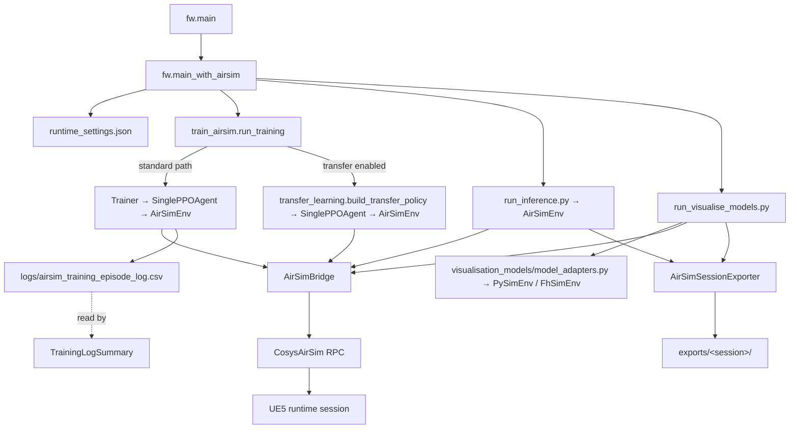
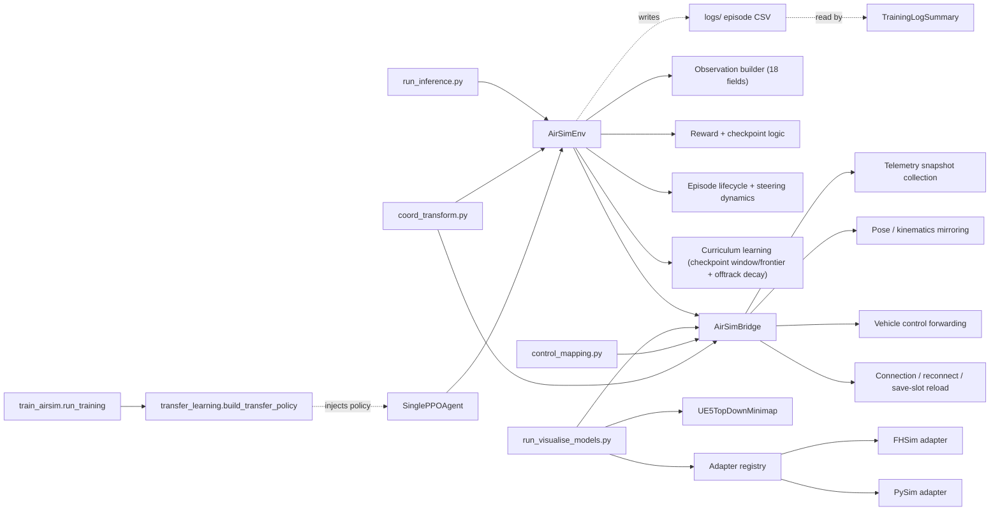
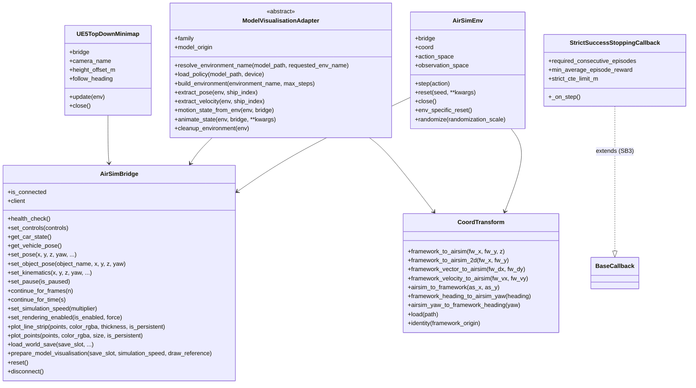
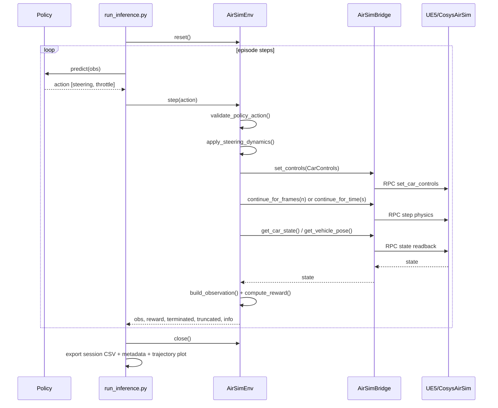
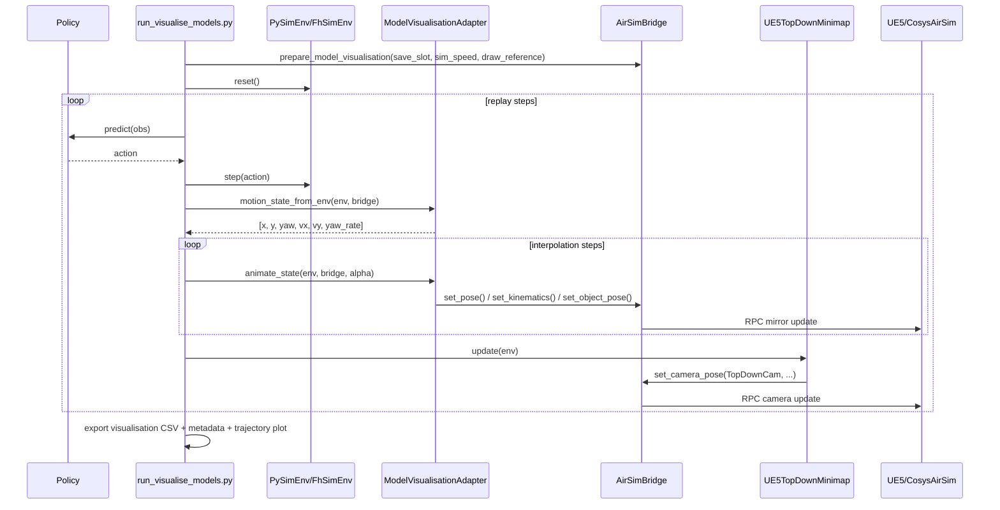

# AirSim Architecture

This document describes the current AirSim subsystem used by RudoLF for:

- UE5-backed training through `AirSimEnv`
- live inference for models trained in `AirSimEnv`
- modular framework-model replay in UE5 through `run_visualise_models.py`

It also documents the main public interfaces of `AirSimBridge` and `AirSimEnv`, the reward and observation structure, and the training control flow.

## Related Docs

- [AirSim Step-By-Step Setup Guide](airsim_setup_step_by_step.md)
- [AirSim Package Reference](../src/airsim/README.md)
- [AirSim Inference and Visualisation Runbook](../src/airsim/inference/README.md)

## C4 System Context


## C4 Container View



## Runtime Routing Overview

The execution routing is controlled in layers.

### Layer 1: framework selection

`src/fw/config.py` decides:

- which simulator(s) are selected through `env_type`
- whether the framework requests `train` or `visualize` through `action`

### Layer 2: ordered framework execution

`src/fw/main.py`:

- resolves the configured environments
- preserves their order
- delegates only `AirSimEnv` steps to `fw.main_with_airsim`
- if an AirSim step fails (UE5 unreachable), that step is skipped and the remaining configured environments continue

### Layer 3: AirSim-specific refinement

`src/fw/main_with_airsim.py` reads `src/airsim/config/runtime_settings.json`.

Within an AirSim step:

- `action = "train"` → AirSimEnv training with configured speed profile
- `action = "visualize"` splits into:
  - modular framework-model replay via `visualization.model_visualise`
  - AirSimEnv inference via `visualization.inference_visualise`

If both AirSim visualisation flags are true, model visualisation wins.

## C4 Component View



## UML Class Diagram



## UML Sequence: AirSimEnv Inference



## UML Sequence: Framework Replay In UE5



## Observation Space

`AirSimEnv` uses observation profile `"ppo_route_relative_car"` — an 18-dimensional continuous vector in the vehicle-fixed frame.

| Index | Field | Description |
|-------|-------|-------------|
| 0 | `current_checkpoint_forward` | Forward distance to current checkpoint |
| 1 | `current_checkpoint_lateral` | Lateral (cross-track) offset to current checkpoint |
| 2 | `next_checkpoint_forward` | Forward distance to next checkpoint |
| 3 | `next_checkpoint_lateral` | Lateral offset to next checkpoint |
| 4 | `target_forward` | Forward distance to final route target |
| 5 | `target_lateral` | Lateral offset to final target |
| 6 | `heading_error_cos` | Cosine of heading alignment error |
| 7 | `heading_error_sin` | Sine of heading alignment error |
| 8 | `cross_track_error` | Current signed lateral deviation from route |
| 9 | `cross_track_error_delta` | Rate of change of cross-track error |
| 10 | `forward_speed` | Surge velocity (m/s) |
| 11 | `yaw_rate` | Angular velocity (rad/s) |
| 12 | `executed_action_steering` | Last applied steering command |
| 13 | `executed_action_throttle` | Last applied throttle command |
| 14 | `route_progress_ratio` | Fraction of total route completed |
| 15 | `checkpoint_progress_ratio` | Progress within current checkpoint window |
| 16 | `previous_action_steering` | Prior steering action (one-step history) |
| 17 | `los_heading_error` | Line-of-sight heading error to next waypoint |

## Reward Structure

`AirSimEnv` uses a shaped reward with optional normalization (clips to `[-1, 1]`).

| Event | Value |
|-------|-------|
| Checkpoint passed | `+1.0` |
| Precision bonus (pass within 8m) | `+0.35` |
| Route success (final target) | `+5.0` |
| Collision | `-5.0` |
| Off-track | `-4.0` |
| Disconnect | `-5.0` |
| Timeout | `-2.5` |

Default normalization scale: `5.0` (divides all shaped rewards before clipping).

## Steering Dynamics

When `steering_dynamics_enabled=true`, policy outputs are not sent raw to UE5.

Two filters are applied in sequence:

1. **Low-pass filter** — exponential smoothing with `steering_smoothing_alpha`
2. **Rate limiter** — clamps the per-step change to `max_steering_rate_per_second × time_step`

This emulates vessel steering inertia and prevents discrete action jumps from destabilizing physics.

## Training Speed Profiles

Configured via `training.speed_profile` in `runtime_settings.json`.

| Profile | `sim_speed` | Pause stepping | `time_step` | Use case |
|---------|-------------|----------------|-------------|----------|
| `normal` | 1.0 | off | 0.1 s | Debug / real-time |
| `safe` | 20.0 | on | 0.05 s | **Recommended for new training** |
| `fast` | 40.0 | on | 0.1 s | Faster iteration |
| `turbo` | 80.0 | on | 0.1 s | Maximum throughput |
| `custom` | configurable | configurable | configurable | Manual override |

`safe` is the recommended default for initial training runs. It combines deterministic pause-stepping with a conservative sim speed to reduce physics instability.

## Curriculum Learning

`AirSimEnv` implements two complementary curriculum mechanisms.

### Soft offtrack-limit decay (always active)

The off-track termination threshold starts permissive and tightens progressively over early episodes, easing initial route exploration regardless of `curriculum_enabled`.

### Checkpoint-based window/frontier curriculum (`curriculum_enabled=true`)

When enabled, each episode start is drawn from a sliding window `[frontier - window + 1, frontier]`. After `curriculum_success_patience` consecutive clean successes (no collision, no offtrack, episode completed within step budget), the frontier advances by `curriculum_frontier_increment` and the window expands by `curriculum_window_increment`. This progressively exposes the full route as the agent matures.

| Config key | Default | Effect |
|-----------|---------|--------|
| `curriculum_enabled` | `false` | Activates checkpoint-based episode start randomization |
| `curriculum_window_size` | `8` | Initial checkpoint window size |
| `curriculum_frontier_increment` | `4` | Frontier growth per advancement |
| `curriculum_window_increment` | `6` | Window growth per advancement |
| `curriculum_success_patience` | `2` | Required consecutive successes |
| `curriculum_randomization_scale` | `0.0` | Gaussian start-position noise (m) |

`TrainingLogSummary` (in `train/training_log_analysis.py`) reads episode CSV logs and recommends a curriculum frontier based on median/modal checkpoint statistics and high-speed offtrack ratios.

## Transfer Learning

Transfer learning from a pretrained 2D policy (any `PySimEnv` or `FhSimEnv` checkpoint) to `AirSimEnv` is implemented in `train/transfer_learning.py`.

### Architecture

The 2D and 3D policies share the same `ActorCriticNetwork` topology, but the first linear layer `shared_network[0]: Linear(input_dim → 256)` differs in shape because the 3D observation space has more features. The transfer strategy:

- `shared_network[0]` is **not** transferred — it stays randomly initialised as the **mapping layer** that learns to project the extra AirSim dimensions into the shared feature space.
- `shared_network[2]`, actor head, and critic head have identical shapes in 2D and 3D and are **transferred + optionally frozen**.

### Pipeline (`build_transfer_policy`)

1. Load 2D source policy on CPU (device-agnostic weight extraction).
2. Compare topology and validate compatibility (`TransferIncompatibilityError` on mismatch).
3. Initialise a fresh 3D `PPOPolicy` on the target device.
4. Copy matching layers; move tensors to target device automatically.
5. Optionally freeze transferred parameters so only the mapping layer trains.

### Configuration (`runtime_settings.json` → `transfer_learning`)

| Key | Default | Effect |
|-----|---------|--------|
| `enabled` | `false` | Route training through the transfer path |
| `source_policy_path` | `models/PySimEnv_PPO_policy.zip` | Source `.zip` (any compatible 2D policy) |
| `freeze_shared_layers` | `true` | Freeze transferred layers; mapping layer stays trainable |

When `enabled=true`, `run_training()` in `train_airsim.py` bypasses the standard Trainer and drives a `SinglePPOAgent` directly, injecting the transferred policy before `learn()` starts. The optimizer is rebuilt over trainable parameters only.

## Early Stopping

The current AirSim training flow stops via `StopCondition(Criterion.NBR_POLICY_UPDATES)` driven by `training.max_policy_updates` in `runtime_settings.json`.

`StrictSuccessStoppingCallback` (in `train/strict_success_callback.py`) is an available SB3-compatible callback that can halt training after N consecutive strict-success episodes. It is **not wired into the default AirSim training path** — it must be explicitly passed to the Trainer if needed.

Success criteria defined by `StrictSuccessStoppingCallback`:

1. All route checkpoints passed
2. Maximum CTE during the episode ≤ `strict_cte_limit_m` (default 10 m)
3. Average episode reward ≥ `min_average_episode_reward` (default 0.95 normalized)

## Coordinate Systems

The framework and AirSim use different reference frames. `CoordTransform` handles bidirectional conversion.

| Frame | X | Y | Heading/Yaw |
|-------|---|---|-------------|
| Framework | East | North | CCW+ from East |
| AirSim (NED) | North | East | CW+ from North |

Conversion: `AirSim_yaw = π/2 − ship_heading`

`calibration.json` stores the anchor pair, scale, rotation, and optional axis mirrors computed by the interactive `calibrate_coords` tool.

## Current Module Layout

```text
src/airsim/
|-- communication/
|   |-- airsim_bridge.py
|   |-- control_mapping.py
|   `-- coord_transform.py
|-- config/
|   |-- airsim_config.py
|   |-- calibration.json
|   `-- runtime_settings.json
|-- environments/
|   `-- airsim_env.py
|-- inference/
|   |-- README.md
|   |-- minimap_models_ue5.py
|   |-- plot_airsim_path.py
|   |-- run_inference.py
|   |-- run_visualise_models.py
|   |-- verify_headless_plot.py
|   `-- visualisation_models/
|       |-- __init__.py
|       `-- model_adapters.py
|-- poc/                          ← historical, not the current reference
|-- train/
|   |-- strict_success_callback.py
|   |-- train_airsim.py
|   |-- training_log_analysis.py
|   `-- transfer_learning.py
`-- verantwoording_workflow.md

src/fw/common/airsim/
|-- classes/
|   `-- path_resolution.py
`-- tools/
    |-- airsim_export.py
    |-- airsim_training_session.py
    |-- analyze_telemetry.py
    |-- angles.py
    |-- calibrate_coords.py
    |-- path_utils.py
    |-- print_ue5_ship_framework_pose.py
    |-- print_ue5_ship_pose.py
    |-- telemetry_export.py
    |-- telemetry_exporter.py
    |-- trajectory_analysis.py
    `-- util.py
```

## Public Interface: `AirSimBridge`

`AirSimBridge` is the public RPC-facing façade for UE5/CosysAirSim.

### Connection and session control

- `is_connected`
- `client`
- `health_check()`
- `load_world_save(save_slot, reload_timeout, poll_interval, reconnect_delay, ...)`
- `prepare_model_visualisation(save_slot, simulation_speed, draw_reference)`
- `reset()`
- `disconnect()`

### Vehicle control and state

- `set_controls(controls)`
- `get_car_state()`
- `get_vehicle_pose()`
- `get_collision_info()`
- `set_pause(is_paused)`
- `continue_for_frames(frames)`
- `continue_for_time(seconds)`
- `is_paused()`
- `set_simulation_speed(multiplier)`
- `set_rendering_enabled(is_enabled, force)`

### Visualisation and mirroring

- `flush_persistent_markers()`
- `plot_line_strip(points, color_rgba, thickness, is_persistent=True)`
- `plot_points(points, color_rgba, size, is_persistent=True)`
- `set_pose(x, y, z, yaw, preserve_current_z, preserve_roll_pitch)`
- `set_object_pose(object_name, x, y, z, yaw)`
- `set_kinematics(x, y, z, yaw, velocities...)`

### Camera support

- `get_camera_info(camera_name, vehicle_name="")`
- `set_camera_pose(camera_name, pose, vehicle_name="")`
- `set_camera_fov(camera_name, fov_degrees, vehicle_name="")`
- `get_camera_image(camera_name, image_type, vehicle_name="", annotation_name="")`
- `get_camera_images(requests, vehicle_name="")`

## Public Interface: `AirSimEnv`

`AirSimEnv` is the Gymnasium-compatible environment backed by UE5 physics.

### Core Gymnasium lifecycle

- `step(action)` — validate → apply steering dynamics → set controls → step physics → read state → compute obs/reward
- `reset(seed=None, **kwargs)` — reload world save, restore ship pose, clear episode state
- `close()` — brake, disconnect bridge, flush telemetry

### Framework integration hooks

- `env_specific_reset()` — called by Trainer during framework-level reset
- `randomize(randomization_scale=None)` — domain randomization (optional)

### Publicly important attributes

- `bridge` — active `AirSimBridge` instance
- `coord` — active `CoordTransform` instance
- `action_space` — continuous Box(2,) in [-1, 1]
- `observation_space` — continuous Box(18,)
- `ship_pos`, `ship_heading`, `ship_speed`
- `checkpoint_index`, `cross_error`

## Configuration Layers

| Layer | File | Controls |
|-------|------|----------|
| Framework selection | `src/fw/config.py` | `env_type`, `action`, hyperparameters |
| AirSim runtime | `src/airsim/config/runtime_settings.json` | training profile, vis flags, connection, replay settings |
| Bridge config | `src/airsim/config/airsim_config.py` | IP, port, timeout, retries, health check interval |
| Calibration | `src/airsim/config/calibration.json` | coordinate anchor pair, scale, rotation, mirrors |

## Output Artifacts

Output paths differ between training and the two inference/visualisation runners.

### Training logs — `logs/`

| File | Written by | Contents |
|------|-----------|---------|
| `logs/airsim_training_episode_log.csv` | `train_airsim.py` | per-episode: checkpoint progress, speed, CTE, outcome |

Path is configurable via `training.episode_log_path` in `runtime_settings.json`. This file is what `TrainingLogSummary` reads when computing curriculum frontier recommendations.

`StrictSuccessStoppingCallback` does not write any files — it monitors SB3 training callbacks in memory only and prints a console message when the stopping threshold is reached.

### Session exports — `exports/<session>/`

Both inference and visualisation runners create a timestamped session folder via `AirSimSessionExporter`.

Folder naming:

- `exports/inference_{model_stem}_{timestamp}/` — from `run_inference.py`
- `exports/visualisation_{family}_{model_stem}_{timestamp}/` — from `run_visualise_models.py`

| File | Created by | Contents |
|------|-----------|---------|
| `inference_session.csv` | `run_inference.py` | per-step reward, obs fields, outcome |
| `visualisation_session.csv` | `run_visualise_models.py` | per-step framework state, controls, outcome |
| `airsim_telemetry.csv` | bridge (via `csv_log_path`) | UE5-side position, velocity, controls, timestamps |
| `metadata.json` | both runners | model info, runtime config, `performance_summary` block |
| `trajectory_2d_vs_3d.png` | both runners | side-by-side 2D (framework) vs 3D (UE5) trajectory |

`metadata.json` includes a `performance_summary` block with:

- total reward, duration
- cumulative 2D and 3D distance
- mean and max cross-track error
- per-episode outcome and metrics

## Runtime Responsibilities

### `run_inference.py`

- dedicated to models trained in `AirSimEnv`
- uses `AirSimEnv.reset()`, `AirSimEnv.step()`, and `AirSimEnv.close()`
- mirrors the training-style action → physics → feedback loop
- computes post-run KPIs from `inference_session.csv` and `airsim_telemetry.csv`
- exports `trajectory_2d_vs_3d.png` with side-by-side trajectory comparison

### `run_visualise_models.py`

- dedicated to framework-model replay in UE5
- resolves model adapter from registry (`pysim`, `fhsim`)
- keeps framework physics authoritative; mirrors motion into UE5
- supports optional UE5 top-down camera minimap
- smooth interpolation between framework steps (`render_interpolation_steps`)
- exports `visualisation_session.csv`, bridge telemetry, trajectory plot

## Test Coverage Map

AirSim-specific tests:

- `tests/airsim/communication/test_bridge.py`
- `tests/airsim/communication/test_control_mapping.py`
- `tests/airsim/communication/test_airsim_bridge.py`
- `tests/airsim/enviroments/test_airsim_env.py` ← folder name is a typo in the repo
- `tests/airsim/inference/test_model_visualisation_dispatch.py`
- `tests/airsim/inference/test_fossen_visualisation_timing.py`
- `tests/airsim/inference/test_visualise_models_minimap_save.py`
- `tests/airsim/inference/test_run_inference_airsim_env.py`
- `tests/airsim/inference/test_visualisation_model_adapters.py`
- `tests/airsim/train/test_train_airsim.py`
- `tests/airsim/train/test_stability.py` — long-run observation stability and reward bounds
- `tests/airsim/train/test_transfer_learning.py` — topology comparison, compatibility validation, weight loading and freeze logic (T-054 – T-056)

Framework-routing tests:

- `tests/fw/test_main_fallback.py`
- `tests/fw/test_env_factory_config.py`
