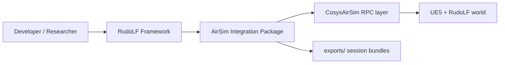
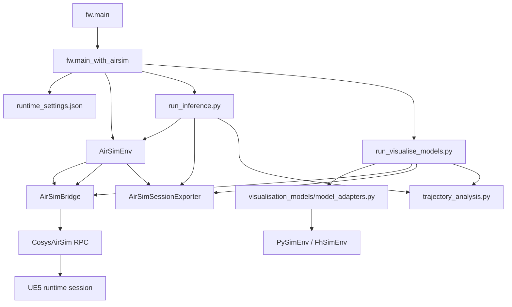
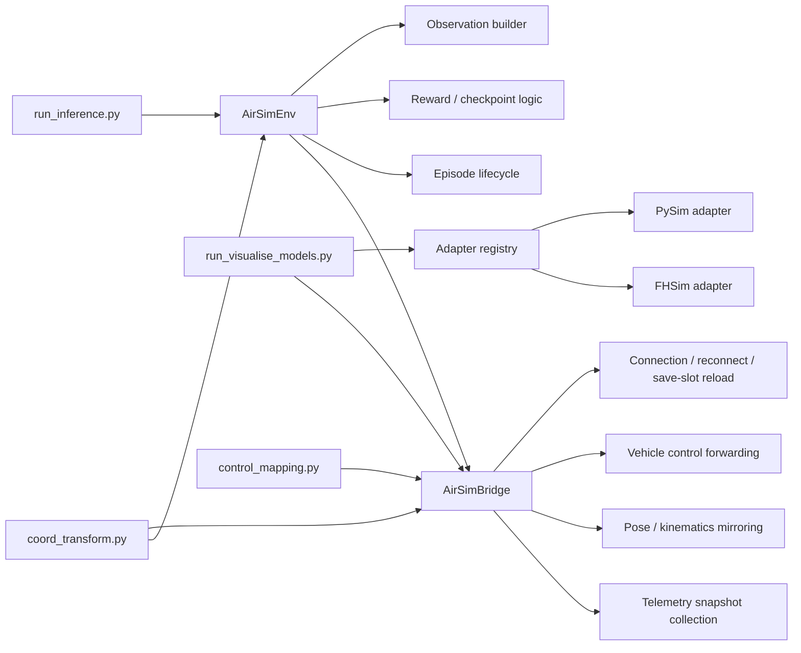
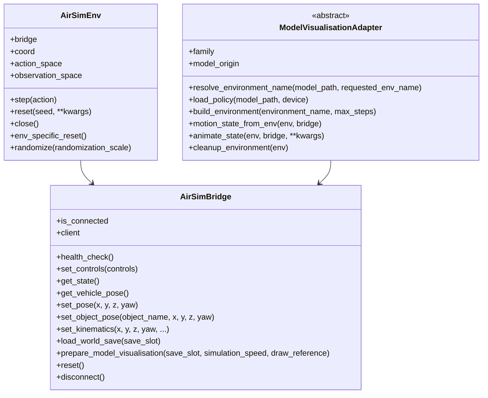
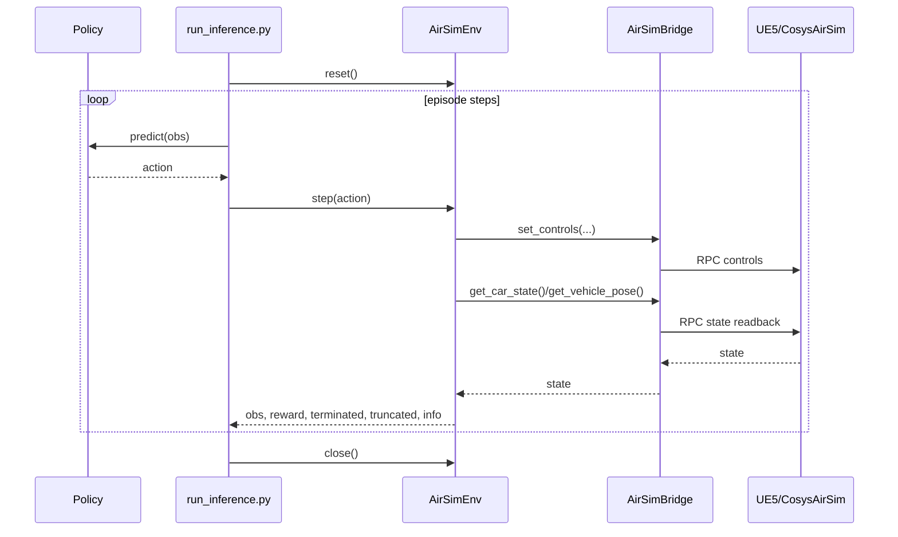
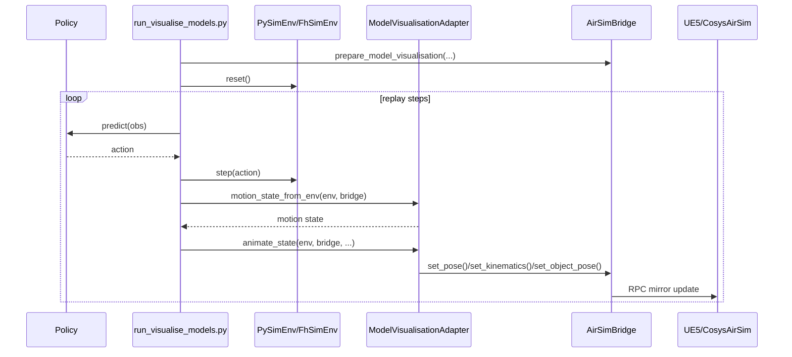

# AirSim Architecture

This document describes the current AirSim subsystem used by RudoLF for:

- UE5-backed training through `AirSimEnv`
- live inference for models trained in `AirSimEnv`
- modular framework-model replay in UE5 through `run_visualise_models.py`

It also documents the main public interfaces of `AirSimBridge` and `AirSimEnv`.

## Related Docs

- [AirSim Step-By-Step Setup Guide](airsim_setup_step_by_step.md)
- [AirSim Package Reference](../src/airsim/README.md)
- [AirSim Inference and Visualisation Runbook](../src/airsim/inference/README.md)

## C4 System Context



## C4 Container View



## Runtime Routing Overview

The execution routing is controlled in layers.

### Layer 1: framework selection

`src/fw/config.py` decides:

- which simulator(s) are selected through `env_type`
- whether the framework requests `train` or `visualize` through `action`

### Layer 2: ordered framework execution

`src/fw/main.py`:

- resolves the configured environments
- preserves their order
- delegates only `AirSimEnv` steps to `fw.main_with_airsim`

### Layer 3: AirSim-specific refinement

`src/fw/main_with_airsim.py` reads `src/airsim/config/runtime_settings.json`.

Within an AirSim step:

- `action = "train"` means AirSimEnv training
- `action = "visualize"` can still split into:
  - modular framework-model replay through `visualization.model_visualise`
  - AirSimEnv inference through `visualization.inference_visualise`

If both AirSim visualisation flags are true, model visualisation wins.

## C4 Component View



## UML Class Diagram



## UML Sequence: AirSimEnv Inference



## UML Sequence: Framework Replay In UE5



## Current Module Layout

```text
src/airsim/
|-- communication/
|   |-- airsim_bridge.py
|   |-- control_mapping.py
|   `-- coord_transform.py
|-- config/
|   |-- airsim_config.py
|   |-- calibration.json
|   `-- runtime_settings.json
|-- environments/
|   `-- airsim_env.py
|-- inference/
|   |-- README.md
|   |-- minimap_fossen_airsim.py
|   |-- minimap_models_ue5.py
|   |-- plot_airsim_path.py
|   |-- run_inference.py
|   |-- run_visualise_models.py
|   `-- visualisation_models/
|       |-- __init__.py
|       `-- model_adapters.py
|-- train/
|   `-- train_airsim.py
`-- verantwoording_workflow.md
```

## Public Interface: `AirSimBridge`

`AirSimBridge` is the public RPC-facing façade for UE5/CosysAirSim.

### Connection and session control

- `is_connected`
- `client`
- `health_check()`
- `load_world_save(save_slot, ...)`
- `prepare_model_visualisation(save_slot, simulation_speed, draw_reference)`
- `reset()`
- `disconnect()`

### Vehicle control and state

- `set_controls(controls)`
- `get_car_state()`
- `get_vehicle_pose()`
- `get_collision_info()`
- `set_pause(is_paused)`
- `continue_for_frames(frames)`
- `is_paused()`
- `set_simulation_speed(simulation_speed)`
- `get_state()`

### Visualisation and mirroring

- `flush_persistent_markers()`
- `plot_line_strip(points, color_rgba, thickness, is_persistent=True)`
- `plot_points(points, color_rgba, size, is_persistent=True)`
- `set_pose(x, y, z, yaw, ...)`
- `set_object_pose(object_name, x, y, z, yaw)`
- `set_kinematics(x, y, z, yaw, ...)`

### Camera support

- `get_camera_info(camera_name, vehicle_name="")`
- `set_camera_pose(camera_name, pose, vehicle_name="")`
- `set_camera_fov(camera_name, fov_degrees, vehicle_name="")`
- `get_camera_image(camera_name, image_type, vehicle_name="", annotation_name="")`
- `get_camera_images(requests, vehicle_name="")`

## Public Interface: `AirSimEnv`

`AirSimEnv` is the Gymnasium-compatible environment backed by UE5 physics.

### Core Gymnasium lifecycle

- `step(action)`
- `reset(seed=None, **kwargs)`
- `close()`

### Framework integration hooks

- `env_specific_reset()`
- `randomize(randomization_scale=None)`

### Publicly important attributes

- `bridge`
- `coord`
- `action_space`
- `observation_space`
- `ship_pos`
- `ship_heading`
- `ship_speed`
- `checkpoint_index`
- `cross_error`

## Runtime Responsibilities

### `run_inference.py`

- dedicated to models trained in `AirSimEnv`
- uses `AirSimEnv.reset()`, `AirSimEnv.step()`, and `AirSimEnv.close()`
- mirrors the training-style action -> physics -> feedback loop
- computes post-run KPIs by reusing `inference_session.csv` and `airsim_telemetry.csv`
- prints a concise console summary (reward, duration, distance, cross-track error)
- exports `trajectory_2d_vs_3d.png` with side-by-side trajectory comparison

### `run_visualise_models.py`

- dedicated to framework-model replay in UE5
- resolves a model adapter
- reuses `visualisation_session.csv` and bridge telemetry for KPI summaries
- exports side-by-side `trajectory_2d_vs_3d.png` for 2D vs 3D comparison
- keeps framework physics authoritative
- mirrors motion into UE5
- supports matplotlib and UE5-camera minimaps

## Configuration Layers

- framework selection: `src/fw/config.py`
- AirSim runtime behavior: `src/airsim/config/runtime_settings.json`
- validated connection config: `src/airsim/config/airsim_config.py`

## Export Artifacts

Each AirSim run creates a timestamped session folder under `exports/`.

Common files:

- `metadata.json`
- `airsim_telemetry.csv`
- `inference_session.csv` or `visualisation_session.csv`

## Test Coverage Map

AirSim-specific tests:

- `tests/airsim/communication/test_bridge.py`
- `tests/airsim/communication/test_control_mapping.py`
- `tests/airsim/communication/test_airsim_bridge.py`
- `tests/airsim/enviroments/test_airsim_env.py`
- `tests/airsim/inference/test_model_visualisation_dispatch.py`
- `tests/airsim/inference/test_fossen_visualisation_timing.py` (timing coverage for model-visualisation interpolation)
- `tests/airsim/inference/test_minimap_layout.py`
- `tests/airsim/inference/test_visualise_models_minimap_save.py`
- `tests/airsim/inference/test_run_inference_airsim_env.py`

Framework-routing tests:

- `tests/fw/test_main_fallback.py`
- `tests/fw/test_env_factory_config.py`
