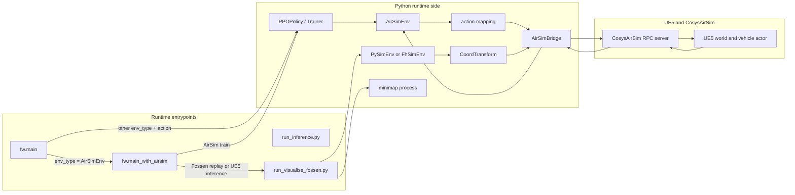
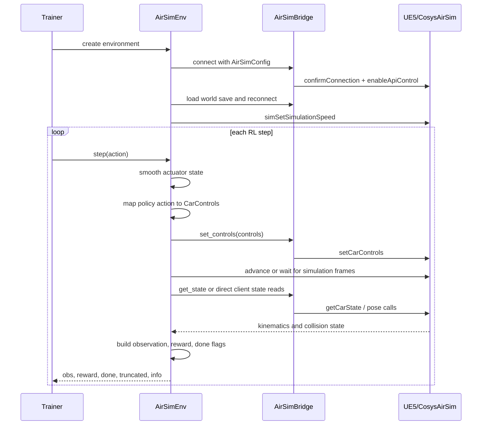
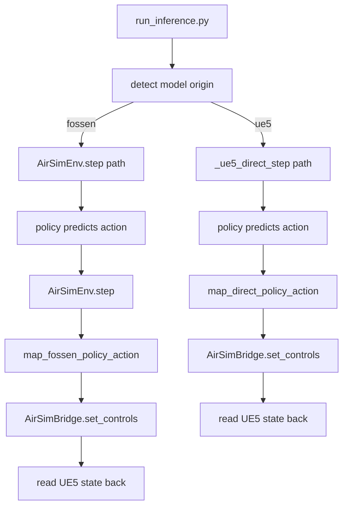
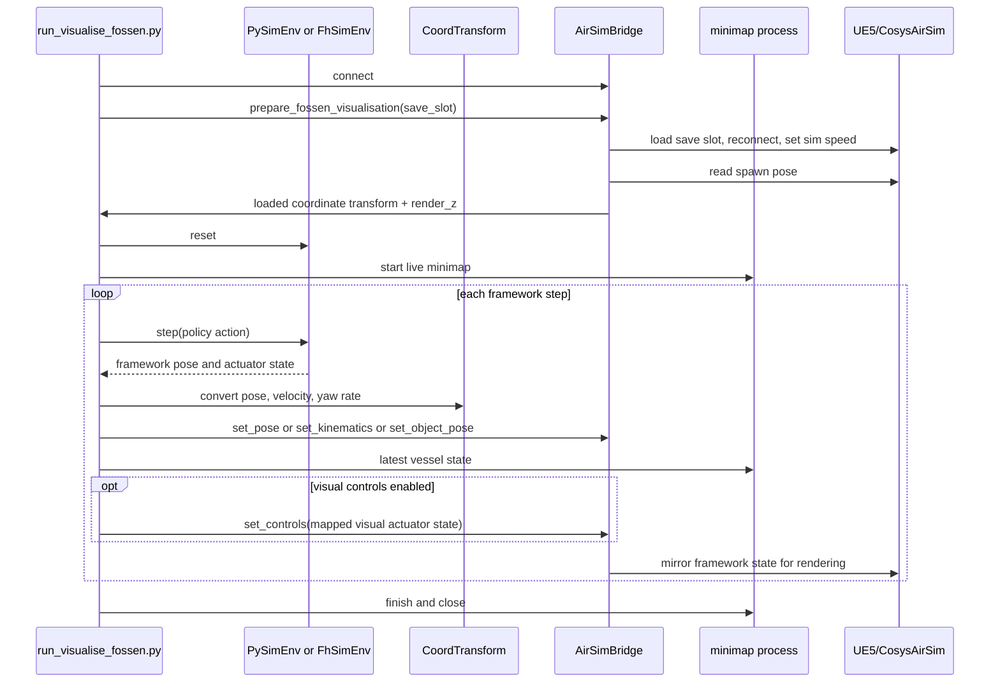

# AirSim Architecture

This document describes the current AirSim subsystem as implemented in `src/airsim`. It reflects the active code paths and runtime responsibilities.

## Package Tree

```text
src/airsim/
|-- __init__.py
|-- communication/
|   |-- airsim_bridge.py
|   |-- control_mapping.py
|   `-- coord_transform.py
|-- config/
|   |-- airsim_config.py
|   |-- calibration.json
|   |-- runtime_settings.json
|   `-- settings_training.json
|-- environments/
|   `-- airsim_env.py
|-- inference/
|   |-- minimap_fossen_airsim.py
|   |-- plot_airsim_path.py
|   |-- run_inference.py
|   |-- run_visualise_fossen.py
|   `-- verify_headless_plot.py
|-- poc/
|   |-- airsim_bridge_PID.py
|   `-- train_airsim.py
|-- tools/
|   |-- analyze_telemetry.py
|   `-- calibrate_coords.py
`-- train/
    `-- train_airsim.py
```

## Responsibility Tree

```mermaid
flowchart TB
    airsim[airsim package]

    airsim --> config[config]
    airsim --> comms[communication]
    airsim --> envs[environments]
    airsim --> infer[inference]
    airsim --> tools[tools]
    airsim --> train[train]
    airsim --> poc[poc]

    config --> cfg[airsim_config.py\nvalidated runtime config]
    config --> cal[calibration.json\nframe alignment data]
    config --> runtime[runtime_settings.json\nentry-point settings]

    comms --> bridge[airsim_bridge.py\nRPC lifecycle, pose/control transport]
    comms --> mapping[control_mapping.py\naction and actuator mapping]
    comms --> transform[coord_transform.py\nFossen <-> AirSim transforms]

    envs --> airsimenv[airsim_env.py\nGymnasium environment using UE5 physics]

    infer --> runinf[run_inference.py\npolicy replay in AirSimEnv]
    infer --> runviz[run_visualise_fossen.py\nFossen replay mirrored into UE5]
    infer --> minimap[minimap_fossen_airsim.py\nlive minimap process]
    infer --> plotpath[plot_airsim_path.py\npath plotting]

    tools --> calib[calibrate_coords.py\ninteractive calibration wizard]
    tools --> telemetry[analyze_telemetry.py\noffline CSV analysis]

    train --> trainue5[train_airsim.py\ntrainer entry point for UE5]

    poc --> oldbridge[legacy bridge snapshot]
```



## Core Design

### 1. Shared services

- `AirSimConfig` centralizes connection and runtime settings.
- `CoordTransform` converts positions, vectors, headings, and yaw rates between the framework's Fossen frame and AirSim's UE5 frame.
- `AirSimBridge` owns the `cosysairsim.CarClient` lifecycle, reconnect logic, world-save reload handling, pose updates, kinematic updates, object-pose updates, control forwarding, and telemetry reads.
- `control_mapping.py` is the only place where policy outputs or actuator states are translated into `CarControls`.

### 2. Two runtime modes

- UE5-native mode: `AirSimEnv` uses UE5 as the physics source of truth. PPO actions are mapped to `CarControls`, sent through `AirSimBridge`, and observations are reconstructed from UE5 state.
- Fossen-visualisation mode: the framework simulator remains the physics source of truth. `run_visualise_fossen.py` steps `PySimEnv` or `FhSimEnv`, converts the resulting motion with `CoordTransform`, and mirrors the motion into UE5 through `AirSimBridge`.
- The live minimap is intentionally isolated in a separate child process, not a thread, so GUI redraws and viewport recentering cannot stall the main replay loop.

### 3. Calibration as a first-class dependency

- Training and inference rely on consistent frame conversion.
- `calibrate_coords.py` produces `calibration.json`.
- `prepare_fossen_visualisation()` loads the calibration and also captures the render `z` level from the currently loaded UE5 save.
- `AirSimEnv` can auto-fall back to an identity axis-swap transform if calibration is unavailable, but calibrated operation is the intended path.

## Runtime Architecture

Framework routing is split across two configuration layers:

- `fw.config.CONFIG_PARAMETERS['env_type']` selects the generic environment and determines whether `fw.main` stays in the framework flow or delegates to `fw.main_with_airsim`.
- `fw.config.CONFIG_PARAMETERS['action']` controls `train` versus `visualize` for the generic non-AirSim framework flow.
- `airsim/config/runtime_settings.json` controls AirSim-specific visualize dispatch (`fossen_visualise`, `inference_visualise`) and training-speed controls through `training.speed_profile` (`safe`, `fast`, `turbo`, `custom`) after the AirSim branch has been selected.
- `runtime_settings.json` is strict JSON; documentation comments are stored in `_remarks` objects.



## Detailed Execution Flows

### A. Training inside UE5



Key points:

- UE5 is the physics engine in this path.
- `AirSimEnv` preserves the framework-style observation and reward interface so the rest of the RL stack can stay unchanged.
- `AirSimBridge` is intentionally thin here: it forwards commands and exposes state transport, but does not decide control laws.
- Training performance can be tuned from `runtime_settings.json` without code edits via `training.speed_profile` or explicit `training.*` values when profile is `custom`.

### B. Direct policy replay through `run_inference.py`



Key points:

- This script supports both older Fossen-trained models and UE5-trained models.
- The branch is chosen from the filename unless the CLI forces a mode.
- In both branches the bridge remains a transport layer.

### C. Fossen visualisation replay through `run_visualise_fossen.py`



Key points:

- Framework physics stays authoritative.
- UE5 is used as a renderer and visual mirror.
- At high `simulation_speed`, visual updates now snap directly when the allocated wall-clock duration becomes shorter than the effective render interval. This avoids adding artificial slowdown through pointless interpolation sleeps.
- The mirror transport can use one of three strategies:
  - `set_pose()` for standard vehicle-pose mirroring.
  - `set_kinematics()` when the installed CosysAirSim build exposes `simSetKinematics`.
  - `set_object_pose()` for moving a non-physics actor without triggering vehicle-water interactions.

## File-to-Role Mapping

- `communication/airsim_bridge.py`: connection setup, reconnection, save-slot reload, `CarControls` forwarding, pose mirroring, kinematic mirroring, telemetry extraction.
- `communication/control_mapping.py`: converts policy outputs and framework actuator states into valid UE5 `CarControls` values.
- `communication/coord_transform.py`: reusable frame-conversion service shared by training, inference, calibration, and visualisation.
- `environments/airsim_env.py`: UE5-backed Gymnasium environment that keeps the framework-compatible observation and reward contract.
- `inference/run_inference.py`: policy replay entry point that can drive UE5-backed inference using `AirSimEnv`.
- `inference/run_visualise_fossen.py`: framework replay entry point that mirrors external physics into UE5.
- `inference/minimap_fossen_airsim.py`: process-isolated visual aid for framework replay episodes, with UE5-aware docking and a local follow-view.
- `tools/calibrate_coords.py`: interactive production of `calibration.json` and overlay verification in UE5.
- `tools/analyze_telemetry.py`: post-run inspection of logged bridge telemetry.
- `train/train_airsim.py`: minimal bridge from the framework trainer into `AirSimEnv`.

## Important Current Constraints

- The active bridge assumes upper layers already decided what controls or poses to send.
- The `poc/` directory is a historical snapshot and should not be used as the reference architecture for current behavior.
- `run_visualise_fossen.py` is the correct reference for current Fossen-to-UE5 visualisation behavior.
- The minimap is not part of the timing-critical replay loop anymore; it runs in a separate process and receives latest-wins position updates.
