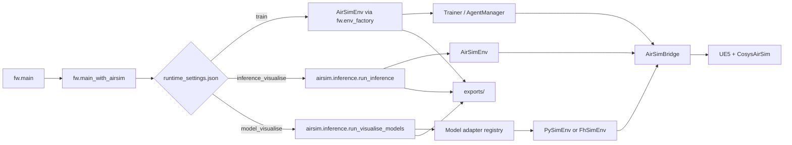
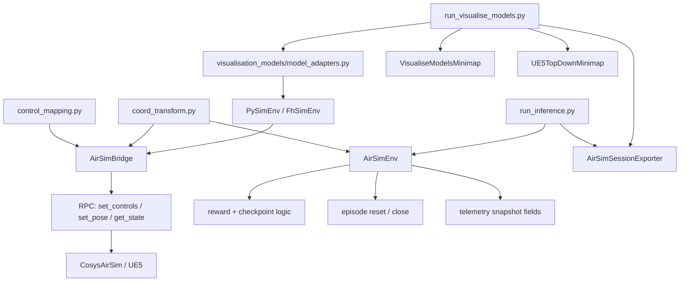

# AirSim Integration Package

`src/airsim` contains the Unreal Engine 5 / CosysAirSim integration layer for the RudoLF framework.

It supports three practical runtime paths:

- `AirSimEnv` training inside UE5.
- `run_inference.py` for policy inference against live UE5 state.
- `run_visualise_models.py` for framework-driven replay where `PySimEnv` or `FhSimEnv` remains authoritative and UE5 is used as renderer.

No UE5 text overlay or in-world status text is currently active. That feature was removed temporarily.

## Scope

The AirSim package is responsible for:

- connecting to CosysAirSim in UE5
- translating between framework and AirSim coordinates
- mapping policy actions to `CarControls`
- exposing a Gymnasium environment backed by UE5
- replaying framework trajectories into UE5
- exporting telemetry and session metadata
- providing matplotlib and UE5-camera minimap options for replay

It is not responsible for:

- policy architecture itself
- scheduler orchestration
- framework environment registration logic
- long-term analytics outside exported CSV/metadata bundles

## Getting Started

If you need the full environment/bootstrap flow, start with:

- [AirSim Step-By-Step Setup Guide](../../docs/airsim_setup_step_by_step.md)
- [AirSim Architecture](../../docs/airsim_architecture.md)

## Top-Level Architecture



## Component Diagram



## How It Fits Into The Framework

### Ordered framework execution

`fw.main` is still the top-level framework entrypoint.

When `env_type` contains `AirSimEnv`, `fw.main` delegates that stage to `fw.main_with_airsim` while keeping the configured environment order intact. This is what allows mixed sequences such as:

```python
["PySimEnv", "AirSimEnv", "PySimEnv"]
```

### Real source of truth

The execution decision is made in this order:

1. `src/fw/config.py`
   - `env_type`
   - `action`
2. `src/fw/main.py`
   - resolves ordered environments
   - delegates `AirSimEnv` steps to `fw.main_with_airsim`
3. `src/fw/main_with_airsim.py`
   - refines the selected AirSim step using `runtime_settings.json`

### AirSim-specialized entrypoint

`fw.main_with_airsim` reads `src/airsim/config/runtime_settings.json` and decides whether it should:

- train through `AirSimEnv`
- run UE5 inference through `run_inference.py`
- run framework replay through `run_visualise_models.py`

`model_visualise` is the primary runtime switch for modular framework-model replay in UE5.

Current checked-in defaults in the source are not neutral:

- `src/fw/config.py`
  - `env_type = ["AirSimEnv"]`
  - `action = "visualize"`
- `src/airsim/config/runtime_settings.json`
  - `visualization.model_visualise = true`
  - `visualization.inference_visualise = false`

So the repository currently defaults to an AirSim model-visualisation workflow
unless those values are changed.

## Package Layout

```text
airsim/
|-- communication/
|   |-- airsim_bridge.py
|   |-- control_mapping.py
|   `-- coord_transform.py
|-- config/
|   |-- airsim_config.py
|   |-- calibration.json
|   `-- runtime_settings.json
|-- environments/
|   `-- airsim_env.py
|-- inference/
|   |-- README.md
|   |-- minimap_fossen_airsim.py
|   |-- minimap_models_ue5.py
|   |-- plot_airsim_path.py
|   |-- run_inference.py
|   |-- run_visualise_models.py
|   `-- visualisation_models/
|       |-- __init__.py
|       `-- model_adapters.py
|-- train/
|   `-- train_airsim.py
`-- verantwoording_workflow.md
```

Shared AirSim utilities live under:

```text
src/fw/common/airsim/
|-- tools/analyze_telemetry.py
|-- tools/angles.py
|-- tools/calibrate_coords.py
`-- tools/path_utils.py
```

## Runtime Paths

### 1. AirSim training

Training uses `AirSimEnv` as the authoritative environment.

This path is selected by:

- `src/fw/config.py`
  - `env_type` includes `AirSimEnv`
  - `action = "train"`
- `src/airsim/config/runtime_settings.json`
  - `training.*` refines the AirSim training behavior

Control flow:

1. policy action enters `AirSimEnv.step()`
2. action is validated and smoothed
3. the AirSimEnv control mapping is applied
4. `AirSimBridge.set_controls()` sends controls to UE5
5. UE5 advances physics
6. AirSim state is read back
7. observation, reward, checkpoint progress, and termination are computed

Key code:

- `src/airsim/environments/airsim_env.py`
- `src/airsim/communication/control_mapping.py`
- `src/airsim/communication/airsim_bridge.py`

### 2. Live inference against UE5

`run_inference.py` is now dedicated to models trained directly in `AirSimEnv`.

This path is selected by:

- `src/fw/config.py`
  - `env_type` includes `AirSimEnv`
  - `action = "visualize"`
- `src/airsim/config/runtime_settings.json`
  - `visualization.inference_visualise = true`
  - `visualization.model_visualise = false`

Its runtime loop intentionally mirrors training:

1. `AirSimEnv.reset()` starts each episode and restores the ship pose
2. the PPO policy predicts an action from the current observation
3. `AirSimEnv.step()` sends controls to UE5, waits for physics, reads back state, and computes reward
4. termination and truncation come directly from `AirSimEnv.step()`
5. `AirSimEnv.close()` shuts the session down cleanly

This means:

- `T-026` is implemented through the native `AirSimEnv` send-action and feedback loop
- `T-027` is implemented through native episode reset, stop detection, and ship repositioning

For framework-trained models such as `PySimEnv` and `FhSimEnv`, `run_visualise_models.py` remains the preferred and supported replay path.

### 3. Framework replay mirrored into UE5

`run_visualise_models.py` keeps framework physics authoritative and mirrors the resulting motion into UE5.

This path is selected by:

- `src/fw/config.py`
  - `env_type` includes `AirSimEnv`
  - `action = "visualize"`
- `src/airsim/config/runtime_settings.json`
  - `visualization.model_visualise = true`

Control flow:

1. adapter is resolved from model family and environment name
2. framework env (`PySimEnv` or `FhSimEnv`) is stepped locally
3. motion state is converted to AirSim coordinates
4. bridge mirrors pose or kinematics into UE5
5. optional minimap is updated
6. visualisation and bridge telemetry are exported

This path is the current reference path for visual model replay.

## Configuration

### Framework-level

In `src/fw/config.py`:

- `env_type`
- `action`

### AirSim runtime configuration

In `src/airsim/config/runtime_settings.json`:

- `airsim`
  - connection, save slot, simulation speed
- `training`
  - pause stepping, frames per step, time step, watchdogs
- `visualization`
  - replay mode selection, minimap options, interpolation, camera settings

Important keys:

- `visualization.model_visualise`
- `visualization.inference_visualise`
- `visualization.model_family`
- `visualization.environment_name`
- `visualization.show_minimap`
- `visualization.use_ue5_camera_minimap`
- `visualization.save_matplotlib_minimap`

## Exports

All AirSim runtime paths write session folders under `exports/`.

Typical files:

- `metadata.json`
- `airsim_telemetry.csv`
- `inference_session.csv` or `visualisation_session.csv`

These are created through `AirSimSessionExporter`.

## Minimap And Plotting

There are currently two replay minimap options:

- `VisualiseModelsMinimap`
  - process-based matplotlib minimap
  - live ship marker + heading line
  - ideal path and waterway geometry
- `UE5TopDownMinimap`
  - top-down camera view rendered from UE5

`plot_airsim_path.py` still exists as a standalone telemetry plotter. It is not currently integrated into the main replay runner.

## Current Visual Cues In UE5

Active:

- persistent path/reference markers drawn with `plot_line_strip`
- start/end points and other debug markers
- minimap rendering when enabled

Inactive for now:

- UE5 HUD status text
- in-world text labels near the ship

## Common Commands

From `src/`:

### Framework entrypoint

```bash
python -m fw.main
```

### AirSim-specialized entrypoint

```bash
python -m fw.main_with_airsim
```

### Live AirSimEnv inference in UE5

```bash
python -m airsim.inference.run_inference --model models/AirSimEnv_PPO_policy.zip
```

### Framework replay in UE5

```bash
python -m airsim.inference.run_visualise_models --model models/PySimEnv_PPO_policy.zip
```

## Related Docs

- [AirSim Step-By-Step Setup Guide](../../docs/airsim_setup_step_by_step.md)
- [AirSim Inference and Visualisation Runbook](inference/README.md)
- [Workflow rationale](verantwoording_workflow.md)
- [Repository-level AirSim architecture](../../docs/airsim_architecture.md)

## Tests

Examples:

```bash
python -m pytest tests/airsim -v
python -m pytest tests/fw/test_main_fallback.py -v
python -m pytest tests/fw/test_env_factory_config.py -v
```

Important modules:

- `tests/airsim/inference/test_model_visualisation_dispatch.py`
- `tests/airsim/inference/test_visualisation_model_adapters.py`
- `tests/airsim/inference/test_visualise_models_minimap_save.py`
- `tests/fw/test_main_fallback.py`
- `tests/fw/test_env_factory_config.py`

## Notes

- `poc/` is historical and not the current reference implementation.
- `run_visualise_models.py` is the preferred replay path for framework-trained policies.
- `run_inference.py` is the preferred path for live UE5-native inference and validation.
