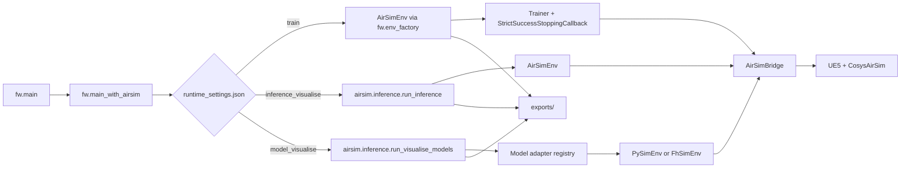
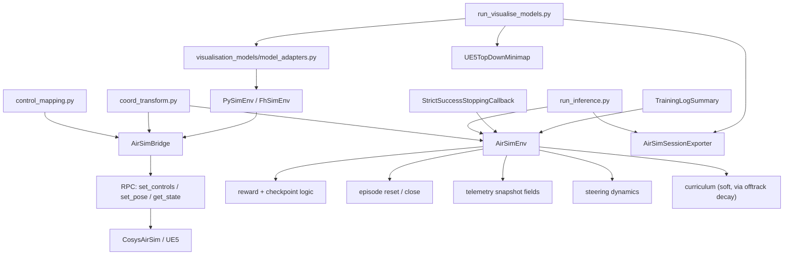

# AirSim Integration Package

`src/airsim` contains the Unreal Engine 5 / CosysAirSim integration layer for the RudoLF framework.

It supports three runtime paths:

- `AirSimEnv` training inside UE5.
- `run_inference.py` for policy inference against live UE5 state.
- `run_visualise_models.py` for framework-driven replay where `PySimEnv` or `FhSimEnv` remains authoritative and UE5 is used as renderer.

No UE5 text overlay or in-world status text is currently active.

## Scope

The AirSim package is responsible for:

- connecting to CosysAirSim in UE5
- translating between framework and AirSim coordinates
- mapping policy actions to `CarControls`
- exposing a Gymnasium environment backed by UE5
- replaying framework trajectories into UE5
- exporting telemetry and session metadata
- providing a UE5-camera top-down minimap for replay

It is not responsible for:

- policy architecture
- scheduler orchestration
- framework environment registration logic
- long-term analytics outside exported CSV/metadata bundles

## Getting Started

If you need the full environment/bootstrap flow, start with:

- [AirSim Step-By-Step Setup Guide](../../docs/airsim_setup_step_by_step.md)
- [AirSim Architecture](../../docs/airsim_architecture.md)

## Top-Level Architecture



## Component Diagram



## How It Fits Into The Framework

### Ordered framework execution

`fw.main` is the top-level framework entrypoint.

When `env_type` contains `AirSimEnv`, `fw.main` delegates that stage to `fw.main_with_airsim` while keeping the configured environment order intact. This is what allows mixed sequences such as:

```python
["PySimEnv", "AirSimEnv", "PySimEnv"]
```

### Real source of truth

The execution decision is made in this order:

1. `src/fw/config.py`
   - `env_type`
   - `action`
2. `src/fw/main.py`
   - resolves ordered environments
   - delegates `AirSimEnv` steps to `fw.main_with_airsim`
3. `src/fw/main_with_airsim.py`
   - refines the selected AirSim step using `runtime_settings.json`

### AirSim-specialized entrypoint

`fw.main_with_airsim` reads `src/airsim/config/runtime_settings.json` and decides whether to:

- train through `AirSimEnv`
- run UE5 inference through `run_inference.py`
- run framework replay through `run_visualise_models.py`

`model_visualise` is the primary runtime switch for modular framework-model replay in UE5.

Current checked-in defaults in the source are not neutral:

- `src/fw/config.py`
  - `env_type = ["AirSimEnv"]`
  - `action = "visualize"`
- `src/airsim/config/runtime_settings.json`
  - `visualization.model_visualise = true`
  - `visualization.inference_visualise = false`

So the repository currently defaults to an AirSim model-visualisation workflow unless those values are changed.

## Package Layout

```text
src/airsim/
|-- communication/
|   |-- airsim_bridge.py
|   |-- control_mapping.py
|   `-- coord_transform.py
|-- config/
|   |-- airsim_config.py
|   |-- calibration.json
|   `-- runtime_settings.json
|-- environments/
|   `-- airsim_env.py
|-- inference/
|   |-- README.md
|   |-- minimap_models_ue5.py
|   |-- plot_airsim_path.py
|   |-- run_inference.py
|   |-- run_visualise_models.py
|   `-- visualisation_models/
|       |-- __init__.py
|       `-- model_adapters.py
|-- train/
|   |-- strict_success_callback.py
|   |-- train_airsim.py
|   `-- training_log_analysis.py
`-- verantwoording_workflow.md
```

Shared AirSim utilities live under:

```text
src/fw/common/airsim/
`-- tools/
    |-- analyze_telemetry.py
    |-- angles.py
    |-- calibrate_coords.py
    `-- path_utils.py
```

## Runtime Paths

### 1. AirSim training

Training uses `AirSimEnv` as the authoritative environment.

This path is selected by:

- `src/fw/config.py`
  - `env_type` includes `AirSimEnv`
  - `action = "train"`
- `src/airsim/config/runtime_settings.json`
  - `training.*` refines the AirSim training behavior

Control flow:

1. policy action enters `AirSimEnv.step()`
2. action is validated and clipped to `[-1, 1]`
3. steering dynamics filter is applied (low-pass + rate limiter)
4. the AirSimEnv control mapping sends `CarControls` to UE5
5. UE5 advances physics (pause-stepping or sim-time-stepping)
6. AirSim state is read back
7. observation, reward, checkpoint progress, and termination are computed

Key code:

- `src/airsim/environments/airsim_env.py`
- `src/airsim/communication/control_mapping.py`
- `src/airsim/communication/airsim_bridge.py`

#### Training speed profiles

| Profile | sim speed | Pause stepping | time_step | Use case |
|---------|-----------|----------------|-----------|---------|
| `normal` | 1.0× | off | 0.1 s | Debug / real-time |
| `safe` | 20.0× | on | 0.05 s | **Recommended for new training** |
| `fast` | 40.0× | on | 0.1 s | Faster iteration |
| `turbo` | 80.0× | on | 0.1 s | Maximum throughput |
| `custom` | configurable | configurable | configurable | Manual override |

Set via `training.speed_profile` in `runtime_settings.json`.

#### Early stopping

`StrictSuccessStoppingCallback` halts training automatically once the policy achieves N consecutive strict-success episodes.

Success criteria per episode:

1. All route checkpoints passed
2. Max CTE ≤ `strict_cte_limit_m` (default 10 m)
3. Average reward ≥ `min_average_episode_reward` (default 0.95 normalized)

#### Curriculum learning

When `curriculum_enabled=true`, `AirSimEnv` applies a soft curriculum via offtrack-limit decay over approximately 450 episodes, allowing the policy to first learn coarse route following before fine tracking is enforced.

`TrainingLogSummary` reads episode CSV logs and recommends a curriculum frontier checkpoint based on median/modal checkpoint progress and high-speed offtrack ratios.

**Full curriculum scheduling and optional transfer learning are the final planned implementation stage and are not yet active.**

### 2. Live inference against UE5

`run_inference.py` is dedicated to models trained directly in `AirSimEnv`.

This path is selected by:

- `src/fw/config.py`
  - `env_type` includes `AirSimEnv`
  - `action = "visualize"`
- `src/airsim/config/runtime_settings.json`
  - `visualization.inference_visualise = true`
  - `visualization.model_visualise = false`

Its runtime loop mirrors training:

1. `AirSimEnv.reset()` starts each episode and restores the ship pose
2. the PPO policy predicts an action from the current observation
3. `AirSimEnv.step()` sends controls to UE5, waits for physics, reads back state, and computes reward
4. termination and truncation come directly from `AirSimEnv.step()`
5. `AirSimEnv.close()` shuts the session down cleanly

For framework-trained models (`PySimEnv`, `FhSimEnv`), `run_visualise_models.py` is the supported replay path.

### 3. Framework replay mirrored into UE5

`run_visualise_models.py` keeps framework physics authoritative and mirrors the resulting motion into UE5.

This path is selected by:

- `src/fw/config.py`
  - `env_type` includes `AirSimEnv`
  - `action = "visualize"`
- `src/airsim/config/runtime_settings.json`
  - `visualization.model_visualise = true`

Control flow:

1. adapter is resolved from model family and environment name
2. framework env (`PySimEnv` or `FhSimEnv`) is stepped locally
3. motion state is converted to AirSim coordinates via `CoordTransform`
4. bridge mirrors pose or kinematics into UE5 with smooth interpolation
5. optional UE5 top-down camera minimap is updated
6. visualisation and bridge telemetry are exported

This path is the current reference path for visual model replay.

## Observation Space

`AirSimEnv` uses observation profile `"ppo_route_relative_car"` — an 18-dimensional continuous vector in the vehicle-fixed frame.

| Index | Field | Description |
|-------|-------|-------------|
| 0 | `current_checkpoint_forward` | Forward distance to current checkpoint |
| 1 | `current_checkpoint_lateral` | Lateral offset to current checkpoint |
| 2 | `next_checkpoint_forward` | Forward distance to next checkpoint |
| 3 | `next_checkpoint_lateral` | Lateral offset to next checkpoint |
| 4 | `target_forward` | Forward distance to final route target |
| 5 | `target_lateral` | Lateral offset to final target |
| 6 | `heading_error_cos` | Cosine of heading alignment error |
| 7 | `heading_error_sin` | Sine of heading alignment error |
| 8 | `cross_track_error` | Current signed lateral deviation from route |
| 9 | `cross_track_error_delta` | Rate of change of cross-track error |
| 10 | `forward_speed` | Surge velocity (m/s) |
| 11 | `yaw_rate` | Angular velocity (rad/s) |
| 12 | `executed_action_steering` | Last applied steering command |
| 13 | `executed_action_throttle` | Last applied throttle command |
| 14 | `route_progress_ratio` | Fraction of total route completed |
| 15 | `checkpoint_progress_ratio` | Progress within current checkpoint window |
| 16 | `previous_action_steering` | Prior steering action (one-step history) |
| 17 | `los_heading_error` | Line-of-sight heading error to next waypoint |

Checkpoints are spaced every 80 m along the route.

## Reward Structure

| Event | Value |
|-------|-------|
| Checkpoint passed | +1.0 |
| Precision bonus (pass within 8 m) | +0.35 |
| Route success (final target) | +5.0 |
| Collision | -5.0 |
| Off-track | -4.0 |
| Disconnect | -5.0 |
| Timeout | -2.5 |

Normalization divides all shaped rewards by `reward_normalization_scale` (default `5.0`) then clips to `[-1, 1]`.

## Coordinate System

| Frame | X | Y | Heading/Yaw |
|-------|---|---|-------------|
| Framework | East | North | CCW+ from East |
| AirSim (NED) | North | East | CW+ from North |

`CoordTransform` handles bidirectional conversion. The anchor pair, scale, rotation, and optional axis mirrors are stored in `calibration.json` and created interactively by `calibrate_coords`.

## Configuration

### Framework-level

In `src/fw/config.py`:

- `env_type`
- `action`

### AirSim runtime configuration

In `src/airsim/config/runtime_settings.json`:

- `airsim` — connection (IP, port, save slot, simulation speed)
- `training` — speed profile, pause stepping, frames per step, time step, curriculum, steering dynamics, reward normalization
- `visualization` — replay mode selection, minimap options, interpolation, camera settings, control animation

Important keys:

- `visualization.model_visualise`
- `visualization.inference_visualise`
- `visualization.model_family`
- `visualization.environment_name`
- `visualization.show_minimap`
- `training.speed_profile`
- `training.curriculum_enabled`
- `training.steering_dynamics_enabled`
- `training.normalize_reward`

## Exports

All AirSim runtime paths write session folders under `exports/`.

| File | Contents |
|------|---------|
| `metadata.json` | model info, runtime config, `performance_summary` |
| `airsim_telemetry.csv` | UE5-side position, velocity, controls, timestamps |
| `inference_session.csv` | per-step reward, obs, outcome (inference runner) |
| `visualisation_session.csv` | per-step framework state, controls (visualisation runner) |
| `trajectory_2d_vs_3d.png` | side-by-side 2D vs 3D trajectory comparison |

`metadata.json` always includes a `performance_summary` block with total reward, duration, 2D/3D distance, mean/max cross-track error, and per-episode outcome.

## Minimap And Plotting

Replay minimap uses:

- `UE5TopDownMinimap` — top-down camera positioned above the ship, rendered from UE5, optionally following ship heading

`plot_airsim_path.py` is a standalone telemetry plotter. It is not integrated into the main runtime runners.

## Current Visual Cues In UE5

Active:

- persistent path/reference markers drawn with `plot_line_strip` and `plot_points`
- start/end debug markers
- optional ship trail (blue persistent line)
- UE5 top-down minimap when `show_minimap=true`

Inactive:

- UE5 HUD status text
- in-world text labels near the ship

## Common Commands

From `src/`:

### Framework entrypoint

```bash
python -m fw.main
```

### AirSim-specialized entrypoint

```bash
python -m fw.main_with_airsim
```

### Live AirSimEnv inference in UE5

```bash
python -m airsim.inference.run_inference --model models/AirSimEnv_PPO_policy.zip
```

### Framework replay in UE5

```bash
python -m airsim.inference.run_visualise_models --model models/PySimEnv_PPO_policy.zip
```

### Coordinate calibration

```bash
python -m fw.common.airsim.tools.calibrate_coords
```

### Telemetry analysis

```bash
python -m fw.common.airsim.tools.analyze_telemetry
```

## Related Docs

- [AirSim Step-By-Step Setup Guide](../../docs/airsim_setup_step_by_step.md)
- [AirSim Inference and Visualisation Runbook](inference/README.md)
- [Workflow rationale](verantwoording_workflow.md)
- [Repository-level AirSim architecture](../../docs/airsim_architecture.md)

## Tests

```bash
python -m pytest tests/airsim -v
python -m pytest tests/fw/test_main_fallback.py -v
python -m pytest tests/fw/test_env_factory_config.py -v
```

Important test modules:

- `tests/airsim/communication/test_bridge.py`
- `tests/airsim/communication/test_control_mapping.py`
- `tests/airsim/environments/test_airsim_env.py`
- `tests/airsim/inference/test_model_visualisation_dispatch.py`
- `tests/airsim/inference/test_visualisation_model_adapters.py`
- `tests/airsim/inference/test_visualise_models_minimap_save.py`
- `tests/airsim/inference/test_run_inference_airsim_env.py`
- `tests/fw/test_main_fallback.py`
- `tests/fw/test_env_factory_config.py`

## Notes

- `poc/` is historical and not the current reference implementation.
- `run_visualise_models.py` is the preferred replay path for framework-trained policies.
- `run_inference.py` is the preferred path for live UE5-native inference and validation.
- Full curriculum scheduling and optional transfer learning are pending (final implementation stage).
