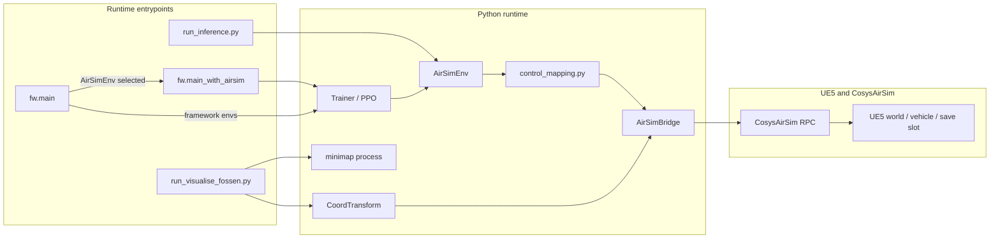

# AirSim Integration Package

> **CosysAirSim bridge, Gymnasium RL environment, coordinate calibration, and analysis tools for training autonomous navigation agents in Unreal Engine 5.**

---

## Overview

The `airsim` package connects the RudoLF reinforcement-learning framework to [CosysAirSim](https://github.com/Cosys-Lab/Cosys-AirSim) — a photorealistic vehicle simulator built on Unreal Engine 5. It enables:

- **RL training inside UE5** — the `AirSimEnv` Gymnasium environment reads vehicle state (position, heading, speed) directly from UE5 and sends steering / throttle commands back, replacing the Fossen mathematical model with UE5's physics engine.
- **Framework-to-UE5 visualisation** — the Fossen framework simulation can be mirrored into UE5 in real time while keeping the framework as the physics source of truth.
- **Coordinate calibration** — an interactive wizard aligns the Fossen (east, north) frame with AirSim's (NED) frame using two reference points, automatically handling scale, rotation, axis mirroring, and origin drift.

### Architecture



The current bridge is a transport and lifecycle layer. It owns the CosysAirSim connection, save-slot reloads, pose mirroring, kinematic mirroring, object-pose mirroring, and telemetry reads. Control laws and action mapping live in upper layers such as `AirSimEnv`, `run_inference.py`, `run_visualise_fossen.py`, and `control_mapping.py`.

For the rationale behind the current `fw.main` and `fw.main_with_airsim` split, see [verantwoording_workflow.md](verantwoording_workflow.md).

For the full tree structure and runtime diagrams, see [../../docs/airsim_architecture.md](../../docs/airsim_architecture.md).

---

## Package Structure

```
airsim/
├── __init__.py                   # Re-exports CoordTransform, get_airsim_config
│
├── config/                       # Configuration & calibration data
│   ├── airsim_config.py          # Validated connection and runtime settings
│   ├── runtime_settings.json     # Python runtime settings and AirSim overrides
│   ├── calibration.json          # Fossen ↔ AirSim coordinate calibration
│   └── settings_training.json    # Manual UE5 / CosysAirSim settings template
│
├── communication/                # UE5 ↔ Fossen communication layer
│   ├── airsim_bridge.py          # RPC lifecycle, control forwarding, pose mirroring
│   ├── control_mapping.py        # Policy and actuator mapping to CarControls
│   └── coord_transform.py        # Bidirectional coordinate mapping
│
├── environments/                 # Gymnasium RL environments
│   └── airsim_env.py             # AirSimEnv — drop-in replacement for PySimEnv
│
├── train/                        # Training scripts
│   └── train_airsim.py           # Entry point for RL training inside UE5
│
├── inference/                    # Visualization & analysis scripts
│   ├── minimap_fossen_airsim.py  # Live minimap for Fossen replay
│   ├── plot_airsim_path.py       # Live dead-reckoning path plotter
│   ├── run_inference.py          # AirSim-backed inference entry point
│   ├── run_visualise_fossen.py   # Fossen replay mirrored into UE5
│   └── verify_headless_plot.py   # CI-friendly headless plot export
│
├── tools/                        # Calibration & telemetry utilities
│   ├── calibrate_coords.py       # Interactive Fossen↔AirSim calibration wizard
│   └── analyze_telemetry.py      # Offline telemetry statistics
│
├── poc/                          # Frozen proof-of-concept snapshots
│   ├── README.md                 # Documents the POC scope
│   ├── airsim_bridge_PID.py      # Historical bridge prototype
│   └── train_airsim.py           # Historical training snapshot
│

Repository-level tests for this package live in:

```

tests/
└── airsim/
├── communication/
│ └── test_bridge.py
├── enviroments/
│ └── test_airsim_env.py
└── inference/
└── test_fossen_visualisation_dispatch.py

```

```

---

## Quick Start

### Prerequisites

| Requirement        | Version | Notes                                     |
| ------------------ | ------- | ----------------------------------------- |
| Python             | ≥ 3.12  |                                           |
| CosysAirSim        | latest  | `pip install cosysairsim`                 |
| Unreal Engine 5    | ≥ 5.3   | With the CosysAirSim plugin + water level |
| Stable Baselines 3 | ≥ 2.0   | `pip install stable-baselines3`           |
| pytest             | ≥ 8.0   | `pip install pytest` (for tests only)     |

### 1 — Calibrate coordinates (one-time)

```bash
cd src
python -m airsim.tools.calibrate_coords
```

Follow the prompts to drive the vehicle to two reference points. The wizard writes `calibration.json` and draws the Fossen polygon overlay in UE5 for visual verification.

### 2 — Train inside UE5

```bash
cd src
python -m fw.main_with_airsim
```

This reads `airsim/config/runtime_settings.json` and launches the AirSim-specific training flow for `AirSimEnv`. The generic alternative is `python -m fw.main`, which delegates into `fw.main_with_airsim` when `fw.config.CONFIG_PARAMETERS['env_type']` is set to `"AirSimEnv"`.

`settings_training.json` is not loaded by the Python runtime. It exists as a manual template for the UE5 / CosysAirSim application settings that you may copy into the simulator-side settings location.

`runtime_settings.json` is valid JSON and therefore cannot contain native comments. Inline explanations are stored under `_remarks` objects.

When you launch through `fw.main`, the framework-level selector lives in `fw.config.CONFIG_PARAMETERS`:

- `env_type = "AirSimEnv"` routes into `fw.main_with_airsim`.
- `action = "train"` or `"visualize"` controls the generic non-AirSim framework path.
- AirSim visualisation itself is selected through `fossen_visualise` or `inference_visualise` in `airsim/config/runtime_settings.json` after the AirSim branch has been selected.
- AirSim training throughput is tuned through `training.speed_profile` (`safe`, `fast`, `turbo`, `custom`) in `airsim/config/runtime_settings.json`.

### 3 — Run inference inside UE5

```bash
cd src
python -m airsim.inference.run_inference --model models/AirSimEnv_PPO_policy.zip
```

This runs a saved PPO policy against `AirSimEnv`. For UE5-trained models, actions are mapped directly to `CarControls`. For older Fossen-trained models, the compatibility path inside `AirSimEnv.step()` is used.

### 4 — Visualise Fossen replay in UE5

To keep the framework physics authoritative and use UE5 as a renderer:

```bash
cd src
python -m airsim.inference.run_visualise_fossen --model models/PySimEnv_PPO_policy.zip
```

This path steps `PySimEnv` or `FhSimEnv`, converts the resulting framework state with `CoordTransform`, and mirrors it into UE5 through `AirSimBridge`.

### 5 — Analyse telemetry

```bash
cd src
python -m airsim.tools.analyze_telemetry
```

### 6 — Run tests

```bash
cd ..
python -m pytest tests/airsim -v
```

---

## Key Components

### `AirSimBridge` — Connection and Transport Layer

**Module:** `airsim.communication.airsim_bridge`

The bridge is responsible for:

- Connecting to `cosysairsim.CarClient` with retry and health-check logic.
- Reloading UE5 save slots and reconnecting after world reloads.
- Forwarding already-mapped `CarControls` objects to UE5.
- Mirroring framework state into UE5 through `set_pose()`, `set_kinematics()`, or `set_object_pose()`.
- Reading vehicle telemetry and optionally buffering it to CSV.

Action mapping happens in `communication/control_mapping.py`, `environments/airsim_env.py`, and the inference entry points.

### `CoordTransform` — Bidirectional Coordinate Mapping

**Module:** `airsim.communication.coord_transform`

Handles the complex mapping between the Fossen (x = east, y = north) and AirSim (x = north, y = east, NED) coordinate frames. Supports:

- **Scale** — different distance units between frames.
- **Rotation** — arbitrary rotation angle.
- **Axis mirroring** — independent X / Y flips.
- **Translation** — different origin positions.
- **Heading ↔ Yaw** conversion with correct mirroring.
- **Origin-drift auto-correction** — compensates for UE5 PlayerStart shifts.

Configured from `calibration.json` (generated by `calibrate_coords.py`).

### `AirSimEnv` — Gymnasium RL Environment

**Module:** `airsim.environments.airsim_env`

A drop-in replacement for `PySimEnv` that uses UE5's physics engine instead of the Fossen mathematical model:

- **Same observation space** (10-dim: velocities, distances, heading errors).
- **Same action space** (`[steering, throttle]` in [-1, 1]).
- **Same reward function** (forward progress + heading alignment + cross-track penalty + rudder penalty).
- **Same termination conditions** (collision, out-of-water, excessive heading change, cross-track limit).

Additional UE5-specific features:

- **Deterministic frame stepping** — pauses UE5 and advances frame-by-frame for reproducible training.
- **Physics-update watchdog** — waits for a newer UE5 timestamp after each paused-frame step and warns when latency exceeds the configured threshold.
- **Training mode** — disables UE5 rendering, fog, particles, shadows to maximise training speed.
- **Drift auto-correction** — detects and compensates for UE5 coordinate-origin shifts.
- **Per-step latency telemetry** — exposes `physics_wait_s`, `step_latency_s`, and `ue5_timestamp` through `step()` info and the episode CSV logger.

### `run_visualise_fossen.py` — Framework Replay Renderer

This entry point keeps `PySimEnv` or `FhSimEnv` as the source of truth and mirrors the resulting motion into UE5. It supports pose mirroring, kinematic mirroring, object-pose mirroring, optional visual steering/throttle animation, and a process-isolated live minimap.

For high replay speeds, the visualisation no longer insists on time-based interpolation when the wall-clock budget per framework step is already shorter than the effective render interval. In that case, the mirror path snaps directly to the target pose to reduce pacing jitter in both UE5 and the minimap.

---

## Configuration Reference

The validated bridge settings live in `airsim/config/airsim_config.py`:

| Parameter               | Default | Description                                 |
| ----------------------- | ------- | ------------------------------------------- |
| `use_airsim`            | `True`  | Enable / disable the AirSim bridge          |
| `ip`                    | `""`    | AirSim server IP, empty meaning localhost   |
| `port`                  | `41451` | AirSim RPC port                             |
| `timeout`               | `10.0`  | Connection timeout in seconds               |
| `max_retries`           | `3`     | Number of reconnect attempts                |
| `health_check_interval` | `30.0`  | Health-check interval in seconds            |
| `csv_log_path`          | `""`    | Optional path for buffered telemetry export |

Higher-level AirSim runtime options for training, inference, and visualisation live in `airsim/config/runtime_settings.json`. Framework routing lives in `fw.config.CONFIG_PARAMETERS`, where `env_type` chooses the environment and `action` chooses generic framework train versus visualize behavior.

Training runtime controls include:

| Runtime key                       | Purpose                                                               |
| --------------------------------- | --------------------------------------------------------------------- |
| `training.speed_profile`          | One-switch preset: `safe`, `fast`, `turbo`, or `custom`.              |
| `training.simulation_speed`       | UE5 speed multiplier used in training mode (`custom` profile).        |
| `training.frames_per_step`        | Number of UE5 physics frames advanced per RL step (`custom` profile). |
| `training.use_pause_stepping`     | Deterministic paused stepping toggle (`custom` profile).              |
| `training.physics_update_timeout` | Watchdog timeout while waiting for paused step completion.            |

Important visualisation-related settings include:

| Runtime key                  | Purpose                                                                          |
| ---------------------------- | -------------------------------------------------------------------------------- |
| `simulation_speed`           | Multiplies UE5 replay speed during training or visualisation.                    |
| `min_render_hz`              | Sets the minimum wall-clock cadence for UE5 pose pushes during framework replay. |
| `render_interpolation_steps` | Requests smoothing steps for mirrored framework motion.                          |
| `show_minimap`               | Enables the live minimap process during Fossen replay.                           |

These settings interact: at high `simulation_speed`, the replay may reach a point where the time budget per framework step becomes smaller than the effective render interval. The current implementation then snaps the visual update directly instead of blocking on interpolation that cannot become visible anyway.

---

## Coordinate Frames

| Frame  | X-axis | Y-axis | Heading reference | Positive direction |
| ------ | ------ | ------ | ----------------- | ------------------ |
| Fossen | East   | North  | From East         | Counter-clockwise  |
| AirSim | North  | East   | From North (NED)  | Clockwise          |

**Conversion:** `AirSim_yaw = π/2 − fossen_heading`

The `CoordTransform` class handles all conversions, including scale, rotation, and axis mirroring as specified in `calibration.json`.

---

## Telemetry

When `csv_log_path` is configured, the bridge can export buffered vehicle telemetry with fields returned by `AirSimBridge.get_state()`, including:

| Column                                | Unit  | Description                   |
| ------------------------------------- | ----- | ----------------------------- |
| `timestamp`                           | —     | AirSim timestamp              |
| `speed`                               | m/s   | AirSim-reported vehicle speed |
| `gear`                                | —     | Current gear                  |
| `pos_x`, `pos_y`, `pos_z`             | m     | AirSim-frame position         |
| `vel_x`, `vel_y`, `vel_z`             | m/s   | Linear velocity components    |
| `ang_vel_x`, `ang_vel_y`, `ang_vel_z` | rad/s | Angular velocity components   |
| `yaw`                                 | rad   | Normalized AirSim yaw         |

Use `python -m airsim.tools.analyze_telemetry` for offline inspection, and see [../../docs/airsim_architecture.md](../../docs/airsim_architecture.md) for how telemetry fits into the overall design.

`AirSimEnv` can additionally write episode-scoped CSV telemetry with the following extra fields:

| Column           | Unit | Description                                          |
| ---------------- | ---- | ---------------------------------------------------- |
| `physics_wait_s` | s    | Time spent waiting for a newer UE5 physics timestamp |
| `step_latency_s` | s    | Total wall-clock duration of the environment step    |
| `ue5_timestamp`  | —    | Last timestamp reported by `getCarState()`           |

---

## Tests

```bash
cd ..
python -m pytest tests/airsim -v
```

The test suite covers:

- **`test_bridge.py`** — connection handling, state conversion helpers, and bridge integration behavior.
- **`test_airsim_env.py`** — observation parity, reset/step behavior, checkpoint loading, and CSV telemetry.
- **`test_control_mapping.py`** — action validation and Fossen-to-UE5 throttle mapping bounds.
- **`test_fossen_visualisation_dispatch.py`** — verifies `fw.main_with_airsim` routes runtime Fossen-visualise mode to `run_visualise_fossen` with expected arguments.
- **`test_minimap_layout.py`** — verifies minimap sizing, docking, and local follow-view helper behaviour.
- **`test_fossen_visualisation_timing.py`** — verifies the snap-versus-interpolate decision used to reduce pacing jitter at high replay speeds.

Tests run without UE5 or CosysAirSim by patching the bridge and environment dependencies directly inside the test modules.
